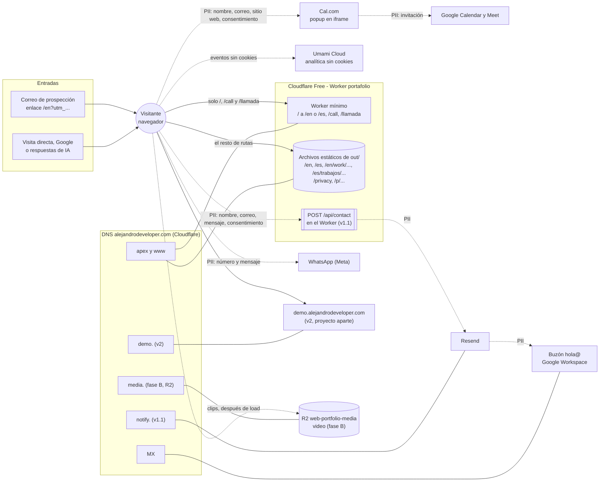
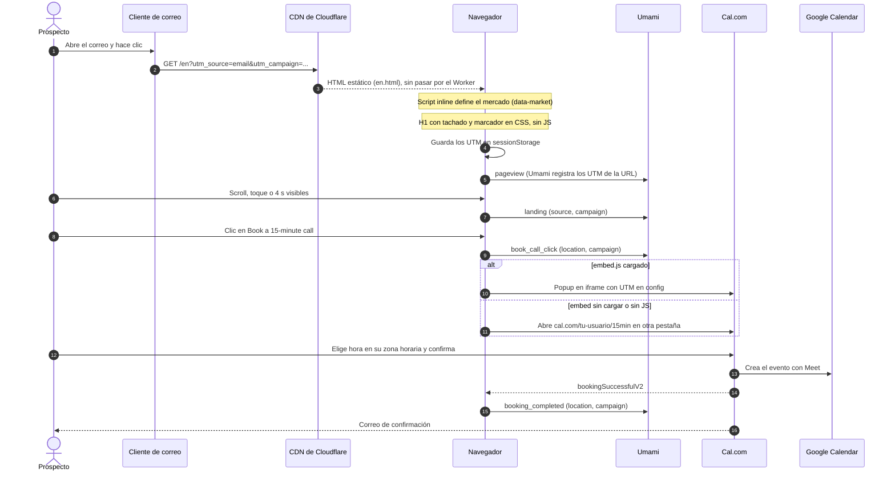
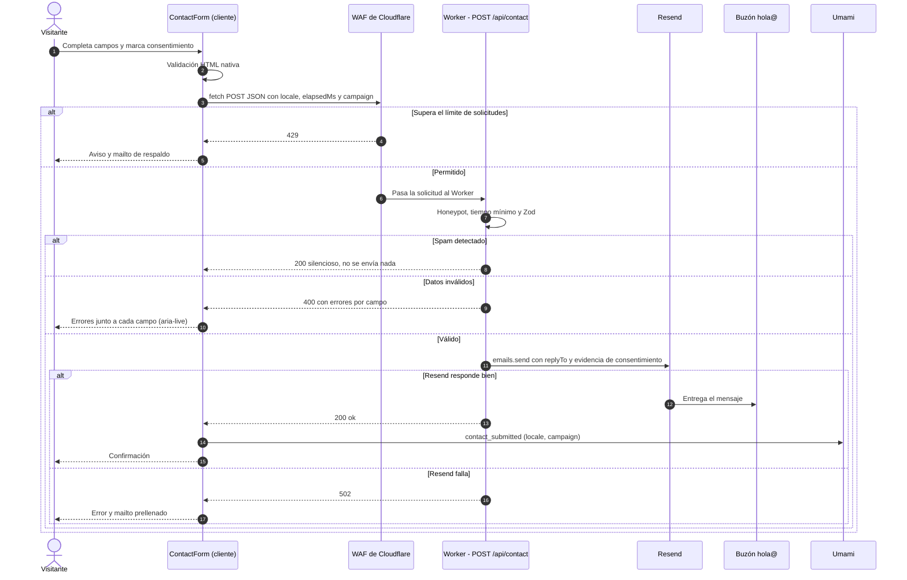
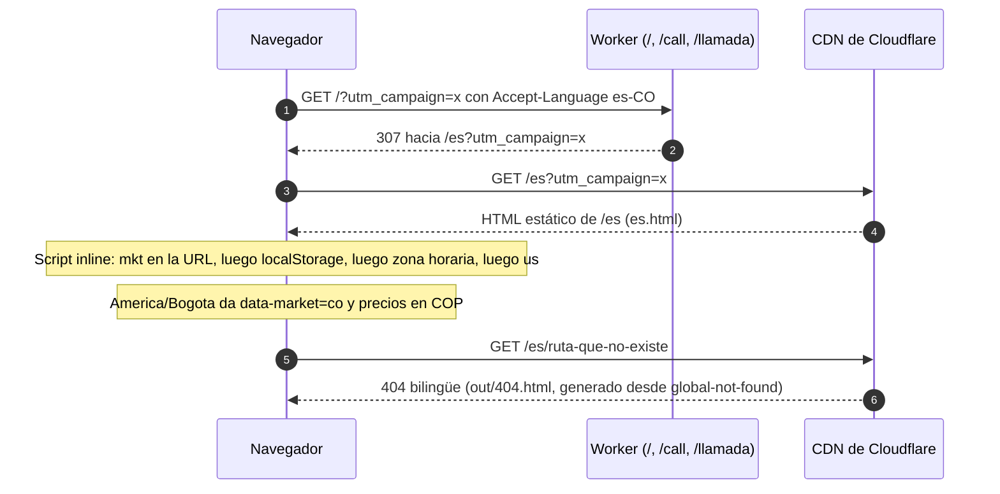

# 03 · Arquitectura

El portafolio es un sitio **100 % estático**. Next.js lo exporta a `out/` y Cloudflare lo sirve desde su CDN, en el plan gratuito. La v1 solo ejecuta código de servidor en un Worker mínimo, que resuelve tres redirecciones: `/` según el idioma del navegador, `/call` y `/llamada`. La v1.1 agrega a ese Worker el formulario (`POST /api/contact`).

Desde la reestructuración del 24-oct ([ADR-020](./14-decisiones.md#adr-020)) el sitio tiene una home por idioma y una página por caso (`/en/work/<slug>`, `/es/trabajos/<slug>`), todas exportadas como HTML. Las capturas viven en el repositorio y se importan con hash ([ADR-021](./14-decisiones.md#adr-021)). En la fase B, el video sale de Cloudflare R2 en `media.alejandrodeveloper.com` ([ADR-022](./14-decisiones.md#adr-022)).

Todo lo dinámico vive en terceros:

- **Cal.com** para la agenda.
- **Resend** para el correo del formulario.
- **WhatsApp** para mensajes.
- **Umami Cloud** para la medición.

---

## 1. Diagrama de contexto y enrutamiento

Las líneas punteadas marcan flujos de datos. Las que dicen **PII** transportan datos personales. Esta misma lista de terceros alimenta la sección de encargados de la [política de privacidad](./09-seguridad-y-privacidad.md#6-privacidad-y-cumplimiento).



**Lectura rápida.** El visitante casi siempre toca solo la CDN de Cloudflare. El Worker entra en juego únicamente en `/`, en los enlaces cortos y, desde la v1.1, en el formulario. Fuera de eso, el visitante solo sale del sitio cuando agenda (Cal.com), escribe (WhatsApp o el formulario) o abre la demo. La analítica de Umami no usa cookies ni recoge datos personales ([Umami](https://umami.is/pricing)).

## 2. Secuencias principales

### 2.1 Del correo a la llamada agendada (v1)



### 2.2 Formulario de contacto (v1.1)



### 2.3 Resolución de idioma, mercado y 404



## 3. Estrategia de render por ruta

| Ruta | Render | Caché | Notas |
|---|---|---|---|
| `/` | Redirección 307 en el Worker | Sin caché (`no-store`) | `es…` en `Accept-Language` → `/es`; lo demás → `/en`; conserva el query string ([04 §2](./04-i18n-contenido-y-precios.md#2-redirección-de-)) |
| `/en`, `/es` | SSG exportado (`en.html`, `es.html`) | CDN | La home |
| `/en/work/[slug]`, `/es/trabajos/[slug]` | SSG con `generateStaticParams` y `dynamicParams = false` (`en/work/malone-road-belt.html`…) | CDN | Página del caso. Cada ruta genera solo su idioma: `/es/work/…`, `/en/trabajos/…` y `/en/work` dan 404 ([04 §1](./04-i18n-contenido-y-precios.md#1-rutas-y-urls)) |
| `/en/privacy`, `/es/privacy` | SSG exportado | CDN | Política por idioma (TSX) |
| `/en/p/[slug]`, `/es/p/[slug]` (v1.1) | SSG con `generateStaticParams` y `dynamicParams = false` | CDN | `noindex` + `X-Robots-Tag` (vía `_headers`); un slug desconocido da 404 |
| `/call`, `/llamada` | Redirección 307 externa en el Worker | Sin caché | Hacia `cal.com/tu-usuario/15min`, conserva los UTM |
| `/api/contact` (v1.1) | Endpoint del Worker | Sin caché | Única parte dinámica |
| `/sitemap.xml`, `/robots.txt` | Estáticos (`sitemap.ts`, `robots.ts` con `dynamic = 'force-static'`) | CDN | 12 URLs (home, Trabajo, Servicios, Sobre mí, política y caso, por idioma; [ADR-024](./14-decisiones.md#adr-024), [ADR-025](./14-decisiones.md#adr-025)); sin `/p/*` |
| Cualquier otra | `out/404.html`, generado desde `global-not-found.tsx` (flag experimental) y servido con estado 404 | CDN | 404 bilingüe ([ADR-013](./14-decisiones.md#adr-013)) |

**Por qué no hay `proxy.ts`.** El export estático no lo soporta ([Next.js](https://nextjs.org/docs/app/guides/static-exports)), y Next 16 lo recomienda como último recurso. Además, `dynamicParams = false` en el layout `[locale]` impide el patrón `[...rest]` para el 404 localizado ([issue #87738](https://github.com/vercel/next.js/issues/87738)). Ver [ADR-002](./14-decisiones.md#adr-002) y [ADR-004](./14-decisiones.md#adr-004).

## 4. Estructura del repositorio

`Code/` será la raíz del repositorio Git. En Workers Builds, el directorio raíz queda en `/`.

```text
Code/
├── docs/                          # esta propuesta
├── public/
│   ├── _headers                   # encabezados de seguridad, caché y noindex (Cloudflare, 09 §2)
│   └── og/                        # og-en.png, og-es.png, case-mrb-en.png, case-mrb-es.png (1200×630, pnpm media:og)
├── scripts/                       # medios, solo en local; no corren en Workers Builds (06 §4, ADR-021)
│   ├── lib/cdp.mjs                # cliente mínimo de Chrome DevTools Protocol (WebSocket de Node 24)
│   ├── lib/render-pdf.swift       # páginas del folleto en PDF a PNG (macOS)
│   ├── capture-screens.mjs        # pnpm media:capture → media-raw/mrb/
│   ├── shots.config.mjs           # qué páginas de malonebelt.com, con qué viewport y datos ficticios
│   ├── build-images.mjs           # pnpm media:images → src/media/ + manifest.generated.ts (sharp)
│   ├── media.config.mjs           # fuentes, anchos, recortes y presupuestos de cada imagen
│   ├── build-og.mjs               # pnpm media:og → public/og/
│   └── og/                        # template.html y la fuente mono de las imágenes OG (con su OFL)
├── media-raw/  media-out/         # capturas crudas y video codificado (fase B); en .gitignore
├── src/
│   ├── app/
│   │   ├── [locale]/
│   │   │   ├── layout.tsx         # root layout: <html lang>, fuentes, script de mercado, analítica, TrackingListener
│   │   │   ├── page.tsx           # la home: compone las secciones dentro de PageShell
│   │   │   ├── work/[slug]/page.tsx      # casos en inglés (/en/work/…): envoltorio de CasePage
│   │   │   ├── trabajos/[slug]/page.tsx  # casos en español (/es/trabajos/…): envoltorio de CasePage
│   │   │   ├── privacy/page.tsx   # política por idioma
│   │   │   └── p/[slug]/          # propuestas (v1.1)
│   │   │       ├── page.tsx
│   │   │       └── opengraph-image.tsx
│   │   ├── global-not-found.tsx   # 404 bilingüe → out/404.html
│   │   ├── globals.css            # Tailwind + tokens del sistema visual (@theme), utilidades stretch-*, label-mono y text-price-long, reglas de mercado y foco
│   │   ├── sitemap.ts             # 12 URLs con hreflang
│   │   ├── robots.ts
│   │   └── icon.svg
│   ├── components/
│   │   ├── layout/                # PageShell (skip link, Header, <main>, Footer), Nav + nav.css (barra y menú Popover), MenuCloser (cliente)
│   │   ├── sections/              # la home: Header, Hero, FiguresStrip, Work, Services, Process, Pricing, About, Faq, Closing, Footer
│   │   ├── hero/                  # HeroHeadline + headline.css (H1); HeroShowcase + showcase.css (marcos del hero); figures.css (franja de cifras); HookStage + hook.css (escenario del bloque B); timeline.ts
│   │   ├── case/                  # CasePage (plantilla, metadata y params), CaseCard (tarjeta de #trabajo), CaseHero, CaseResults, CaseOverview, CaseBeforeAfter, CaseFeatures, CaseClosing; case-media.ts; case.css
│   │   ├── media/                 # ResponsiveImage (<picture> + preloadImage), DeviceFrame + device-frame.css; fase B: LoopVideo y CompareSlider (cliente)
│   │   ├── ui/                    # ButtonLink, Container (+ Section), SectionHeading (+ SectionIndex), Price, Chip, Icon; section.css (fondo de plano)
│   │   ├── booking/               # BookCallLink (servidor) + CalLoader (cliente)
│   │   ├── analytics/             # TrackingListener (cliente)
│   │   ├── market/                # MarketToggle (cliente)
│   │   └── contact/               # ContactForm (cliente, v1.1)
│   ├── content/
│   │   ├── types.ts               # SiteContent, CaseStudy, CaseContent, Metric, FigureCell, PriceSpec…
│   │   ├── en.ts / es.ts          # todos los textos visibles, también los de cada caso (cases.<id>)
│   │   ├── cases.ts               # los casos como datos: slug por idioma, disclosure, cliente, fechas, cifras y medios
│   │   ├── site.ts                # configuración: flags, enlaces, datos de contacto, ID de Umami, media.baseUrl (fase B)
│   │   └── proposals/             # un archivo .ts por propuesta (v1.1)
│   ├── media/                     # imágenes codificadas, versionadas (pnpm media:images)
│   │   ├── index.ts               # hasMedia() y getMedia(); solo para Server Components
│   │   ├── types.ts               # MediaEntry, MediaSource
│   │   ├── manifest.generated.ts  # generado: importa cada archivo, con tamaños y anchos
│   │   ├── mrb/                   # AVIF y WebP por ancho, el logo SVG y el folleto
│   │   └── portrait/  demo/       # el retrato (R-09) y el póster de la demo (v2), cuando existan
│   ├── fonts/                     # Archivo recortada (woff2) y su licencia OFL; cómo regenerarla en 06 §3.2
│   └── lib/
│       ├── i18n.ts                # locales, currentLocale(), getContent() y dictionary(lang) (next/root-params; solo servidor)
│       ├── routes.ts              # CASE_SEGMENT, SECTION, CASE_SECTION, NAV_SECTIONS, casePath(), sectionHref(), alternates
│       ├── cases.ts               # fillCase() y resolveMetrics(): cifras del caso dentro del copy; null las omite
│       ├── fonts.ts               # Archivo (next/font/local, de src/fonts/) e IBM Plex Mono 500 (next/font/google); compartido por el layout y el 404
│       ├── format.ts              # pad2(): la numeración 01, 02… de índices, planes, pasos y preguntas
│       ├── market.ts              # script inline y formato de moneda (priceParts)
│       ├── links.ts               # whatsappHref(), mailtoHref(), calHref() y publicFileExists() (imágenes OG)
│       ├── analytics.ts           # nombres de eventos (tipo unión) y track() sobre Umami
│       ├── utm.ts                 # captura y lectura de UTM
│       └── jsonld.ts              # homeJsonLd() y caseJsonLd(), tipados con schema-dts
├── worker/
│   ├── index.ts                   # redirecciones de /, /call y /llamada; en v1.1 enruta /api/contact
│   ├── contact.ts                 # formulario (v1.1)
│   ├── tsconfig.json              # tipos del runtime de Cloudflare, separados de los del navegador
│   └── worker-configuration.d.ts  # generado con `pnpm cf-typegen`; se commitea
├── next.config.ts                 # output: 'export', imágenes sin optimizador, flag globalNotFound
├── wrangler.jsonc                 # Worker, archivos de out/, dominio y rutas que pasan por el Worker
├── CLAUDE.md                      # reglas para agentes (ver README); importa AGENTS.md
├── AGENTS.md                      # reglas de Next para agentes; `next dev` lo mantiene
├── .nvmrc                         # 24
├── package.json / pnpm-lock.yaml / pnpm-workspace.yaml   # este último aprueba los scripts de instalación (pnpm 12)
├── tsconfig.json / eslint.config.mjs / postcss.config.mjs / .prettierrc / .prettierignore
└── .dev.vars.example              # (v1.1) RESEND_API_KEY para `wrangler dev`; .dev.vars va en .gitignore
```

## 5. Componentes de servidor y de cliente

Todo es Server Component salvo **4 islas de cliente** en la fase A, todas pequeñas y sin dependencias. Con el formulario (v1.1) y las dos islas de la fase B llegan a 7. Las islas nuevas de la reestructuración deben sumar ≤ ~3 KB ([ADR-020](./14-decisiones.md#adr-020)):

| Componente | Tipo | Responsabilidad | Carga |
|---|---|---|---|
| `TrackingListener` | Cliente | Un listener de clics en fase de captura que lee `data-track`; IntersectionObserver para `data-track-view`; captura de UTM y evento `landing` ([12 §4](./12-medicion-y-analitica.md#4-implementación)) | Tras la hidratación |
| `CalLoader` | Cliente | Carga `embed.js` de Cal.com en idle o con la primera intención; registra `bookingSuccessfulV2` ([07 §2](./07-integraciones.md#2-agenda-con-calcom)) | Diferida |
| `MarketToggle` | Cliente | Botones USD/COP: guarda en `localStorage` y cambia `html[data-market]` ([04 §8](./04-i18n-contenido-y-precios.md#8-precios-por-país-del-visitante)) | Tras la hidratación |
| `MenuCloser` | Cliente | Cierra el menú Popover al tocar uno de sus enlaces y cuando el foco sale del panel con Tab. Esc, el cierre al tocar fuera y el foco de vuelta al botón los resuelve el navegador ([06 §3.5](./06-secciones-y-ui.md#35-movimiento-estados-y-foco)). ~0,35 KB | Tras la hidratación |
| `ContactForm` (v1.1) | Cliente | Estados del formulario y `fetch` a `/api/contact` | Tras la hidratación |
| `LoopVideo` (fase B) | Cliente | Reproduce un clip mudo solo en vista y después de `load`, con botón de pausa; con "reducir movimiento" o Save-Data deja la portada ([ADR-022](./14-decisiones.md#adr-022)) | Tras `load` |
| `CompareSlider` (fase B, condicional) | Cliente | Deslizador antes/después accesible con teclado; sin JS quedan los paneles. Solo si aparece una captura de "antes" ([ADR-023](./14-decisiones.md#adr-023)) | Tras la hidratación |
| Script de mercado | Script inline en `<head>` | Decide `data-market` antes del primer pintado. No es un componente de React | Bloqueante, ~300 B |

Las CTAs, enlaces y textos se renderizan en el servidor como `<a>` reales con atributos `data-*`. Funcionan sin JavaScript y no agregan JS por botón.

También son de servidor, con 0 KB de JS, las piezas visuales de la fase A: `HeroShowcase`, `FiguresStrip`, `DeviceFrame`, `ResponsiveImage`, el bento de Servicios y todas las secciones del caso. El escenario del bloque B arranca al entrar en vista solo con CSS ([05 §5](./05-hero-animacion.md#5-estructura-del-componente)). `src/media/` solo lo importan Server Components: cada entrada del manifiesto arrastra su import, que inflaría el JS del cliente.

**Contratos que comparten las páginas:**

- **`PageShell`** (`layout/`) recibe `lang`, `alternates` (la misma página en cada idioma, para el enlace de idioma), `current` (la sección marcada con `aria-current`) e hijos. Dibuja el enlace para saltar, el `Header` con la `Nav`, `<main id="main">` y el `Footer`. Lo usan la home, la política y los casos.
- **`CasePage`** (`case/`) es la plantilla única de los casos. Exporta también `caseMetadata(lang, slug)` y `caseStaticParams(lang)`. Next llama al `generateStaticParams` hijo una vez por cada `locale` del padre y falla el export si alguna llamada devuelve `[]`, así que `caseStaticParams` devuelve `{ locale: lang, slug }`: Next mezcla esos params sobre los del padre y descarta los duplicados, y las combinaciones cruzadas nunca se generan.
- **`src/lib/routes.ts`** arma todas las URLs internas; ningún componente las escribe a mano.

## 6. Rutas, encabezados y configuración

Con el export estático, `next.config.ts` ya no maneja redirecciones ni encabezados ([ADR-017](./14-decisiones.md#adr-017)). Esa responsabilidad se reparte así:

| Archivo | Contenido | Doc |
|---|---|---|
| `next.config.ts` | `output: 'export'`; `images.unoptimized: true`; `experimental.globalNotFound: true` | [06 §4](./06-secciones-y-ui.md#4-imágenes), [ADR-013](./14-decisiones.md#adr-013) |
| `worker/index.ts` | `/` por `Accept-Language`; `/call` y `/llamada` hacia Cal.com; desde la v1.1, `/api/contact` | [04 §2](./04-i18n-contenido-y-precios.md#2-redirección-de-), [07 §5](./07-integraciones.md#5-formulario-de-contacto-v11) |
| `public/_headers` | Encabezados de seguridad; CSP Report-Only; caché inmutable de `/_next/static/*`; `X-Robots-Tag` para `/p/*` y para las URL de `workers.dev` | [09 §2](./09-seguridad-y-privacidad.md#2-encabezados-http), [08 §6](./08-seo.md#6-noindex-de-propuestas-y-demo) |
| `wrangler.jsonc` | Nombre del Worker, carpeta `out/`, 404, rutas que pasan primero por el Worker y dominio | [10 §6](./10-infraestructura-y-entornos.md#6-cloudflare) |

```ts
// next.config.ts (extracto)
const nextConfig: NextConfig = {
  output: 'export',              // `next build` genera out/ con HTML, CSS, JS e imágenes
  images: { unoptimized: true }, // el export no incluye optimizador; las imágenes llegan optimizadas (06 §4)
  experimental: { globalNotFound: true },
}
```

```jsonc
// wrangler.jsonc — se commitea ANTES de conectar Workers Builds: sin este archivo,
// Cloudflare autoconfigura el proyecto con vinext y abre un PR
{
  "$schema": "node_modules/wrangler/config-schema.json",
  "name": "web-portfolio",
  "main": "worker/index.ts",
  "compatibility_date": "2026-10-01",
  "assets": {
    "directory": "./out",
    "binding": "ASSETS",
    "not_found_handling": "404-page",       // sirve out/404.html con estado 404
    "html_handling": "auto-trailing-slash", // /en → en.html
    "run_worker_first": ["/", "/call", "/llamada"] // v1.1: + "/api/*"
  },
  "routes": [{ "pattern": "alejandrodeveloper.com", "custom_domain": true }],
  "workers_dev": false, // la URL workers.dev de producción no envía noindex
  "preview_urls": true  // previews por rama en workers.dev, con noindex
}
```

- **Solo las rutas de `run_worker_first` ejecutan el Worker** y cuentan para las 100.000 invocaciones diarias del plan Free. El resto lo sirven los archivos estáticos, gratis y sin límite ([Cloudflare](https://developers.cloudflare.com/workers/static-assets/billing-and-limitations/)).
- **`www` → apex no va aquí.** Se configura en Cloudflare como una Redirect Rule 308 ([10 §6](./10-infraestructura-y-entornos.md#6-cloudflare)).
- **No se activa Workers Cache.** Si se activa, las solicitudes a archivos estáticos pasan a cobrarse ([Cloudflare](https://developers.cloudflare.com/workers/cache/)).

## 7. Convenciones de código

- **Idioma:** código, identificadores, commits y comentarios en inglés; docs en español; textos visibles solo en `src/content/{en,es}.ts`.
- **Nombres:** componentes en `PascalCase.tsx`; utilidades en `kebab-case.ts`; alias de import `@/` hacia `src/`.
- **Estilos:** utilidades de Tailwind con los tokens de `globals.css` ([06 §3](./06-secciones-y-ui.md#3-sistema-visual)).
  - Hay CSS propio, junto a su componente, solo para lo que las utilidades no expresan bien: `hero/hook.css` (escenario, keyframes y disparo al entrar en vista), `hero/headline.css` (decoraciones del H1), `hero/showcase.css` (composición de los marcos del hero), `hero/figures.css` (cifras con unidades de contenedor), `layout/nav.css` (barra y menú Popover), `media/device-frame.css` (marcos de navegador y celular), `case/case.css` (placas y puente del caso) y `ui/section.css` (fondo de plano).
  - En esos archivos, las clases van en BEM con prefijo por componente (`hook__*`, `headline__*`, `showcase__*`, `figures__*`, `device__*`, `site-menu`, `case-plate`, `section--grid`).
  - Nada de estilos inline, salvo las variables CSS de tiempo del hook y del H1 (`--t`, `--d`) y la proporción de cada marco (`--device-aspect`).
  - El design system de `Design system/` es la referencia visual: sus clases `ah-*` no se copian.
- **URLs internas desde `lib/routes.ts`:** `casePath()`, `sectionHref()`, `homePath()` y los `alternates`. Los ids de sección están en español en los dos idiomas (`/en#trabajo` también vale).
- **Medios:** una imagen se nombra por su clave del manifiesto (`'mrb/home-desktop'`) y se dibuja con `ResponsiveImage`, nunca con `next/image` ni con rutas a `public/`. Una clave sin archivo no se dibuja.
- **Enlaces internos con `<a>`, no con `next/link`.** En el export de Next 16, el prefetch de `next/link` pide los payloads RSC en rutas equivocadas y da 404 ([issue #85374](https://github.com/vercel/next.js/issues/85374)). Entre páginas estáticas, un `<a>` es igual de rápido. Por eso la regla de ESLint `@next/next/no-html-link-for-pages` está desactivada en `eslint.config.mjs`.
- **Datos de seguimiento:** toda CTA lleva `data-track` y `data-track-location`, con valores de la unión de tipos en `lib/analytics.ts`, para evitar errores de tipeo.
- **Commits:** [Conventional Commits](https://www.conventionalcommits.org/) (`feat:`, `fix:`, `docs:`…). Ramas cortas y un PR por tarea del [plan](./13-plan-de-implementacion.md), para tener una preview de Cloudflare por cada una.
- **Decisiones:** si una tarea cambia una decisión de [14](./14-decisiones.md), se actualiza el ADR en el mismo PR.

## 8. Cómo crece

- **v1.1:** se agregan `worker/contact.ts`, `ContactForm`, la ruta `p/[slug]` y `content/proposals/`, y `/api/*` entra en `run_worker_first`. Aparece el primer secreto (`RESEND_API_KEY`), como secreto del Worker.
- **Fase B:** `media/LoopVideo` y, si aparece una captura de "antes", `media/CompareSlider`; los clips salen de `site.media.baseUrl` (R2) y la CSP suma `media-src` ([ADR-022](./14-decisiones.md#adr-022)). Los revelados y las transiciones de vista son CSS ([ADR-023](./14-decisiones.md#adr-023)).
- **Otro caso:** un objeto en `content/cases.ts`, sus textos en `en.ts` y `es.ts` (`cases.<id>`), sus capturas en `scripts/shots.config.mjs` y `scripts/media.config.mjs`, y su imagen OG. Las rutas, el sitemap y el JSON-LD salen solos.
- **v2:** la tarjeta de la demo en el hueco `demo` de `Work` + `features.demoStore = true`. La demo vive en otro proyecto, con su hosting definido en sus propios docs ([07 §6](./07-integraciones.md#6-tienda-demo-v2-contrato-de-integración)).
- **v3:** una ruta `/[locale]/diagnostico` (o `/audit`) con su endpoint en el Worker y una base de datos para los leads, por ejemplo D1 de Cloudflare o Neon ([07 §7](./07-integraciones.md#7-v3-esbozo-del-diagnóstico-automático-hook-c)).

## Fuentes

- [Next.js: internacionalización](https://nextjs.org/docs/app/guides/internationalization)
- [`next/root-params`](https://nextjs.org/docs/app/api-reference/functions/next-root-params)
- [Next.js: export estático](https://nextjs.org/docs/app/guides/static-exports)
- [`proxy.js`](https://nextjs.org/docs/app/api-reference/file-conventions/proxy)
- [`not-found` y `global-not-found`](https://nextjs.org/docs/app/api-reference/file-conventions/not-found)
- [Issue #87738](https://github.com/vercel/next.js/issues/87738)
- [Issue #85374](https://github.com/vercel/next.js/issues/85374)
- [Cloudflare: static assets y `run_worker_first`](https://developers.cloudflare.com/workers/static-assets/binding/)
- [Cloudflare: precios y límites de static assets](https://developers.cloudflare.com/workers/static-assets/billing-and-limitations/)
- [Cloudflare: configuración automática de Workers Builds](https://developers.cloudflare.com/workers/framework-guides/automatic-configuration/)
- [Umami: precios y privacidad](https://umami.is/pricing)

Consultadas el 3-oct-2026; hosting y analítica, el 4-oct-2026; rutas de los casos, el 24-oct-2026.
