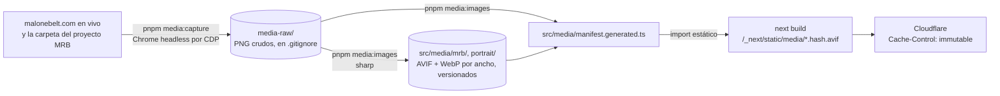

# 06 · Secciones y UI

El sitio tiene una home de 7 secciones más el hero, una página por caso y la política de privacidad, todas con la misma barra fija y el mismo pie ([ADR-020](./14-decisiones.md#adr-020)). La home cubre las secciones del roadmap (§5): "Qué resuelvo" vive dentro de Servicios y la demo será una tarjeta de Trabajo. Todas son Server Components; la interactividad se reduce a 4 islas de cliente pequeñas ([03 §5](./03-arquitectura.md#5-componentes-de-servidor-y-de-cliente)).

La UI usa Tailwind 4 con los tokens del sistema visual "plano técnico" (§3, [ADR-019](./14-decisiones.md#adr-019)), dos familias tipográficas (Archivo variable e IBM Plex Mono), íconos SVG inline, `
` nativo para las preguntas frecuentes, la Popover API para el menú y capturas reales en marcos dibujados en CSS (§4, [ADR-021](./14-decisiones.md#adr-021)). No hay librería de componentes ([ADR-015](./14-decisiones.md#adr-015)).

---

## 1. Mapa de secciones

Desde la reestructuración del 24-oct ([ADR-020](./14-decisiones.md#adr-020)) y los cambios del 25-oct ([ADR-024](./14-decisiones.md#adr-024) y [ADR-025](./14-decisiones.md#adr-025)) hay cinco tipos de página, todas dentro de `PageShell`: la home, la de Trabajo, la de Servicios, la de Sobre mí y una página por caso. Todas las secciones son Server Components. Mientras `site.features.pricing` esté apagado, ninguna muestra precios: LinkedIn ocupa su lugar ([ADR-025](./14-decisiones.md#adr-025)).

**Home** (`/en`, `/es`):

| Índice | Sección | Ancla | Componente | Banda | Contenido (`SiteContent`) | Eventos | Versión |
|---|---|---|---|---|---|---|---|
| — | Barra fija con el nombre (sin lema) y 3 menús desplegables (Trabajo, Servicios, Sobre mí) | — | `Header` + `Nav` + `nav-items.ts` (+ `MenuCloser`) | Papel translúcido | `nav`, los casos destacados y `services.tiles` | `book_call_click` (`header`; `nav` en el menú); `case_open` y `linkedin_open` (`nav`) | Fase A |
| — | Hero | `#inicio` | `Hero` + `HeroHeadline` + `HeroShowcase` + `FiguresStrip` | `paper` + cuadrícula | `hero`, el caso destacado y `pricing` (o el `fallback` de la celda de precio) | `book_call_click` y `case_open` (`hero`); `demo_open` (`hero`, v2) | v1 / fase A |
| 01 | Trabajo, resumen de la página: lo que hago, categorías, industrias y proyectos | `#trabajo` | `Work` | `paper` | `work`, `CaseStudy.categories`, `cases.<id>.card` | `case_mrb_view` (`data-track-view`); `case_open` (`work`) | Fase A |
| 02 | Servicios ("Qué incluye tu tienda"), resumen de la página | `#servicios` | `Services` + `HookStage` | `sunken` | `services` | — | Fase A |
| 03 | Sobre mí, resumen de la página: presentación, 4 pasos y los 3 precios o la tarjeta de LinkedIn | `#sobre-mi` | `AboutTeaser` + `Price` o `LinkedInCard` | `paper` | `about`, `aboutTeaser`, `process.steps`, `pricing.plans`, `linkedin` | `linkedin_open` (`about`) | Fase A |
| 04 | Preguntas frecuentes | `#preguntas` | `Faq` | `tint` | `faq` (máx. 8) | — | v1 |
| 05 | Contacto | `#contacto` | `Closing` (+ `ContactForm` en v1.1) | `accent` | `closing`, `contactForm` | `book_call_click`, `whatsapp_click` y `email_click` (`closing`); `contact_submitted` (v1.1) | v1 / v1.1 |
| — | Pie | — | `Footer` | Azul profundo | `footer`, `nav` y `site.legal` | `case_open` y `linkedin_open` (`footer`) | v1 / fase A |

**Trabajo** (`/en/work`, `/es/trabajos`; `WorkPage`):

| Índice | Sección | Ancla | Componente | Banda | Contenido | Eventos |
|---|---|---|---|---|---|---|
| — | Hero: ruta, H1 "Trabajo, caso por caso" e introducción de uno o varios casos | `#inicio` | `WorkPage` + `Breadcrumb` | `paper` + cuadrícula | `workPage` | — |
| 01… | Una banda por caso destacado con su tarjeta, numerada y alternando tono y lado; los demos con `kind: 'demo'` | el slug del caso (`#malone-road-belt`) | `CaseCard` | `paper` y `raised`, alternadas | `work.card`, `cases.<id>.card` | `case_open` (`work`) |
| siguiente | Contacto | `#contacto` | `Closing` | `accent` | `closing` | como en la home |

**Servicios** (`/en/services`, `/es/servicios`; `ServicesPage`):

| Índice | Sección | Ancla | Componente | Banda | Contenido | Eventos |
|---|---|---|---|---|---|---|
| — | Hero: ruta, H1 e índice de los 7 servicios | `#inicio` | `ServicesPage` + `Breadcrumb` | `paper` + cuadrícula | `servicesPage` | — |
| 01–07 | Un bloque por servicio, en el orden del bento, con el ejemplo de cada caso destacado (el de diseño es el folleto bajo el logo; el plan mensual muestra su plan, y su precio solo con `site.features.pricing`) | `#catalogo`, `#cotizador`, `#diseno`, `#idiomas`, `#google-e-ia`, `#analitica`, `#plan-mensual` | `ServiceBlock` + `Example` (+ `Capture` de `CaseFeatures`) | `paper` y `raised`, alternadas | `services.tiles`, `servicesPage.items`, `CaseStudy.examples`, `cases.<id>.examples` | `case_open` (`services`) |
| 08 | Contacto | `#contacto` | `Closing` | `accent` | `closing` | como en la home |

**Sobre mí** (`/en/about`, `/es/sobre-mi`; `AboutPage`):

| Índice | Sección | Ancla | Componente | Banda | Contenido | Eventos |
|---|---|---|---|---|---|---|
| — | Hero: "Trabajas directamente conmigo", retrato y datos | `#inicio` | `About` + `Breadcrumb` | `paper` + cuadrícula | `about`, `aboutPage` | — |
| 01 | Cómo trabajo | `#proceso` | `Process` | `ink` | `process` | — |
| 02 | Precios de referencia, solo con `site.features.pricing` | `#precios` | `Pricing` + `Price` + `MarketToggle` | `paper` | `pricing` | `book_call_click` (`pricing`); `currency_switch` |
| 02 | "Conóceme mejor", mientras los precios estén ocultos | `#linkedin` | `LinkedIn` + `LinkedInCard` | `paper` | `linkedin` | `linkedin_open` (`about`) |
| 03 | Contacto | `#contacto` | `Closing` | `accent` | `closing` | como en la home |

**Página del caso** (`/en/work/<slug>`, `/es/trabajos/<slug>`; plantilla `CasePage`):

| Índice | Sección | Ancla | Componente | Banda | Contenido (`cases.<id>.page`) | Eventos |
|---|---|---|---|---|---|---|
| — | Hero | `#inicio` (H1 `inicio-title`) | `CaseHero` | `paper` + cuadrícula | `hero`, `breadcrumb`, `visitSite` | — |
| 01 | Resultados | `#resultados` | `CaseResults` | `ink` | `results` | — |
| 02 | Resumen | `#resumen` | `CaseOverview` | `paper` | `overview` | — |
| 03 | Antes y después | `#antes-despues` | `CaseBeforeAfter` | `tint` | `beforeAfter` | — |
| 04 | Qué construí | `#que-construi` | `CaseFeatures` | `paper` | `features` | — |
| 05 | Cierre y "siguiente" | `#cierre` | `CaseClosing` | `accent`, y la tarjeta "siguiente" en papel | `closing`, `next` | `book_call_click` (`case`) |

En la fase B, el teaser de 49 s entra entre "Qué construí" y el cierre ([ADR-022](./14-decisiones.md#adr-022)).

Islas de cliente globales: `TrackingListener` y `CalLoader`, montadas una sola vez en el layout. `MenuCloser` va en la barra de cada página ([03 §5](./03-arquitectura.md#5-componentes-de-servidor-y-de-cliente)).

**Índice visible.** El recuadro mono de cada encabezado (`SectionHeading index`) numera las secciones en el orden en pantalla, sin contar el hero: 01 a 05 en la home, uno por caso y el contacto en Trabajo, 01 a 08 en Servicios, 01 a 03 en Sobre mí y 01 a 05 en el caso. Los ids de `src/lib/routes.ts` (`SECTION`, `CASE_SECTION`, `ABOUT_SECTION`, `SERVICE_ANCHOR`) son la fuente de verdad. Un demo entra como un caso más, en la página de Trabajo y en el resumen de la home ([ADR-025](./14-decisiones.md#adr-025)).

## 2. Contenido por sección

Los textos viven en `content/{en,es}.ts` ([04 §4](./04-i18n-contenido-y-precios.md#4-modelo-de-contenido-tipado)). Las cifras del caso se nombran con marcadores (`{products}`…) y una cifra en `null` oculta lo que la usa, sin dejar hueco.

**Barra.**

- **Desde 1024 px:** el nombre en tipografía a la izquierda (no hay logo ni lema desde [ADR-025](./14-decisiones.md#adr-025)). A la derecha: los 3 menús desplegables (Trabajo, Servicios y Sobre mí, [ADR-024](./14-decisiones.md#adr-024)), una línea fina, el enlace de idioma ("English" / "Español", con `lang` propio) y el botón "Agenda una llamada" / "Book a call".
- **En menos de 1024 px:** el nombre, el botón compacto "Agenda" y el botón "Menú", que abre el panel con los 3 grupos y sus elementos, el idioma y el CTA completo (§3.5).
- **Elementos:** Trabajo lista los casos y "Todo el trabajo" (la página de Trabajo); Servicios, los 7 servicios; Sobre mí, quién soy, cómo trabajo y, mientras los precios estén ocultos, LinkedIn en una pestaña nueva. En la página de Trabajo y en los casos, "Trabajo" va marcado como actual.

**Hero** ([05](./05-hero-animacion.md)):

| | EN | ES |
|---|---|---|
| Titular (`a`) | From “call for pricing” to “add to cart”. | De “precio por interno” a “agregar al carrito”. |
| Subtítulo | I design and build online stores and quote systems for businesses that sell products. You see a working prototype in 5 days, before you commit to the full build. | Diseño y construyo tiendas y catálogos con cotizador para negocios que venden productos. Ves un prototipo funcionando en 5 días, antes de comprometerte con el proyecto completo. |
| CTA principal | Book a 15-minute call | Agenda una llamada de 15 minutos |
| CTA secundario | See the Malone Road Belt case (página del caso) → Try the demo store (v2) | Ver el caso de Malone Road Belt → Prueba la tienda demo (v2) |
| Confianza | You work directly with me · Colombia, UTC−5 | Trabajas directamente conmigo · Colombia, UTC−5 |

Además: los marcos con la home y el cotizador de MRB (`HeroShowcase`) y la franja de 4 cifras (`FiguresStrip`, [05 §5.4](./05-hero-animacion.md#54-franja-de-cifras-figuresstrip)). Mientras los precios estén ocultos, la cuarta cifra es "100 % del dominio, el hosting y las cuentas, a tu nombre".

El titular usa comillas tipográficas “ ”: `HeroHeadline` tacha la primera frase entre comillas y marca la segunda con el resaltador ([05 §3](./05-hero-animacion.md#3-guion--línea-de-tiempo-técnica)). Las variantes `b` y `c` no tienen dos frases entre comillas y se ven como texto plano.

**01 Trabajo** ("Trabajo reciente" / "Recent work"), resumen de la página de Trabajo ([ADR-025](./14-decisiones.md#adr-025)):

- **Izquierda (5 columnas desde 1024 px):** una entrada grande con lo que hago y el botón "Ver todo mi trabajo".
- **Derecha (7 columnas):** una hoja de datos con regla de tinta y tres filas: "Qué he construido" (chips de `work.categories` que tiene algún caso), "Industrias" (chips oscuros con `cases.<id>.card.industry`, sin repetir) y "Proyectos" (una fila por caso con su miniatura, su nombre y su resultado, que lleva a su página).
- **En celular:** una columna, con el texto y el botón primero.

**Tarjeta de caso** (`CaseCard`), en la página de Trabajo: una por caso destacado (`featuredCases`), numerada, con el resultado como H2 y los resultados primero:

- **Izquierda (7 columnas desde 1024 px):** la captura completa de la home de MRB (`mrb/home-full-desktop`) en un marco de navegador con pantalla cuadrada, sobre una placa cobalto con la cuadrícula de plano. Se desplaza hacia abajo en ~3 s mientras se pasa el mouse o el foco por cualquier parte de la tarjeta (`data-device-hover`). En pantallas táctiles (`hover: none`), que nunca la desplazan, se descarga solo su cuadrado superior (`mrb/home-full-top`).
- **Derecha (5 columnas):**
  - la línea mono "Malone Road Belt · Correas industriales · EE. UU.";
  - el resultado como H3: "De cotizar por teléfono a recibir solicitudes en línea, en 3 idiomas";
  - las 3 primeras métricas con valor, como filas: un número grande sobre la banda sol y su etiqueta mono (hoy 3 idiomas, 15 productos y 29 marcas OEM; la de cotizaciones entra primero cuando exista);
  - 4 chips de lo que se construyó;
  - el botón "Ver el caso completo" (`case_open`, `work`) y el enlace "Visitar malonebelt.com" (pestaña nueva, `noopener`).
- **En celular:** la imagen primero y luego el texto.
- **Demos:** entran como casos con `kind: 'demo'`, con el chip "Demo · proyecto propio" y sin cifras ([ADR-024](./14-decisiones.md#adr-024)).

**02 Servicios** ("Qué incluye tu tienda" / "What your store includes"). Absorbe "Qué resuelvo": sus tres frases son ahora las etiquetas de resultado de los bloques. Es una cuadrícula *bento*:

| Bloque | Desde 1024 px | Etiqueta (ES) | Título | Media o prueba |
|---|---|---|---|---|
| A · `catalog` | 2 × 2 | Que te elijan | Catálogo con búsqueda y filtros | La búsqueda de MRB (`mrb/search-desktop`) en un marco de navegador recortado por los bordes del bloque; "{products} productos en Malone Road Belt" |
| B · `quote` | 1 × 2 | Que te compren o coticen | Cotizador o carrito | El escenario del hook A ([05 §5.1](./05-hero-animacion.md#51-escenario-hookstage)) |
| G · `design` | 2 × 1 | Que te recuerden | Diseño de tu sitio y tu marca | El folleto abierto de MRB (`mrb/brochure-spread`) al lado del texto; "Sitio, logo y folleto de Malone Road Belt" |
| C · `languages` | 1 × 1 | Que te entiendan | Varios idiomas | La home de MRB en portugués (`mrb/home-pt-desktop`); "{languages} idiomas en Malone Road Belt" |
| D · `seo` | 1 × 1 | Que te encuentren | Google y respuestas de IA | Lista mono: páginas de producto, datos estructurados, sitemap y hreflang, perfil de Google Business |
| E · `analytics` | 1 × 1 | Que sepas qué te piden | Analítica de cotizaciones | Lista mono: solicitudes por semana, pedidos si vendes en línea, productos por los que te preguntan |
| F · `care` | 1 × 1 | Que siga mejorando | Plan mensual de cuidado | El precio por mercado, solo con `site.features.pricing` |
| O | 3 × 1, azul profundo | — | "Dominio, hosting y cuentas a tu nombre." | "Ver precios" a `/sobre-mi#precios`, o "Ver cómo trabajo" a `/sobre-mi#proceso` mientras los precios estén ocultos |

- **Desde 1024 px,** las filas son `A A B / A A B / G G C / D E F / O O O` ([ADR-025](./14-decisiones.md#adr-025)).
- **En tableta:** A a todo el ancho, luego B G, C D y E F, y O a todo el ancho. **En celular:** una columna en el orden del DOM, con A y B primero.
- **Las etiquetas de C, E y F son nuevas** y llevan `REVIEW(R-08)`, igual que la lista de E.

**03 Cómo trabajo.** Cuatro pasos, cada uno con su chip de duración:

1. Prototipo gratis · 5 días hábiles.
2. Construcción por fases · 3–6 semanas · 40/40/20.
3. Lanzamiento · En tu dominio.
4. Plan mensual · Opcional.

Debajo, dos celdas: "Cada viernes recibes una actualización" y "3 rondas de cambios por fase".

**04 Servicios y precios "desde".** Tres planes, en una tabla con reglas, con nombre, para quién es, qué incluye (3–4 viñetas) y precio por mercado ([04 §8.3](./04-i18n-contenido-y-precios.md#83-formato-de-moneda)). Se agrega:

- Una nota: "Precios de referencia; el valor final depende del alcance" / "Starting prices; final quote depends on scope".
- El selector USD / COP.
- Una fila de acción pegada a la tabla: "Pide tu prototipo gratis" (agenda, `pricing`) y el enlace "Preguntas sobre pagos y tiempos" a `#preguntas`.

El prototipo se presenta como **gratis y sin compromiso** (decisión del 6-oct; antes era pagado y descontable del proyecto).

**05 Sobre mí** ("Trabajas directamente conmigo" / "You work directly with me"). Una entrada grande en primera persona y una tabla de datos: desde Colombia · UTC−5, español e inglés, respuesta en máximo 1 día hábil, más de 4 años construyendo software y "También diseñé el logo, el folleto y el video de producto de Malone Road Belt" (con `REVIEW(R-08)`). **Sin nombrar al empleador actual**, ni aquí ni en JSON-LD ([08 §4](./08-seo.md#4-datos-estructurados-json-ld)). Con `portrait/about` en el manifiesto, el retrato 4:5 va al lado; sin él, el texto ocupa todo el ancho.

**06 Preguntas frecuentes.** Máximo 8, con el título fijo al hacer scroll:

1. ¿El dominio y el hosting quedan a mi nombre?
2. ¿Cuánto tarda el proyecto?
3. ¿Cómo son los pagos? (40 % al iniciar, 40 % con el primer avance aprobado y 20 % al publicar)
4. ¿Cuántas rondas de cambios incluye?
5. ¿Qué pasa si después del prototipo no seguimos?
6. ¿Trabajas con mi plataforma actual (Shopify, WooCommerce, Wix)?
7. ¿Cómo nos comunicamos y en qué horario?
8. ¿Qué necesito tener listo (catálogo, fotos, precios)?

**07 Contacto.** Título y una línea, más tres acciones:

- Agenda (botón principal, amarillo sol con ícono de calendario).
- WhatsApp (con mensaje prellenado por idioma). Solo aparece cuando `whatsappHref()` devuelve un enlace: mientras el número sea el marcador (F0-13), no se muestra.
- Correo `hola@alejandrodeveloper.com`.

En la v1.1 se suma el formulario en un panel.

**Pie.** Una banda azul profunda en todas las páginas:

- **Arriba:** el nombre y el descriptor; la navegación repetida (`footer.navLabel`), con índices mono en sol; el enlace al caso (`case_open`, `footer`), LinkedIn (pestaña nueva, `linkedin_open`), la política de privacidad y el idioma.
- **Abajo:** una línea fina, el © y la dirección postal (la misma de los correos a EE. UU.). Mientras `site.legal.postalAddress` sea el marcador "Por definir", la dirección no se muestra.
- Todos los enlaces miden 44 px de alto.

**Página del caso** (`cases.mrb.page`; todo el copy lleva `REVIEW(R-08)`):

1. **Hero:**
   - miga mono "Trabajo / Malone Road Belt", que vuelve a la página de Trabajo (`/en/work`, `/es/trabajos`; el JSON-LD sí incluye Inicio);
   - el resultado como único H1: "De cotizar por teléfono a recibir solicitudes en línea";
   - el resumen a la izquierda (8 de 12 columnas) y "Visitar malonebelt.com" a la derecha;
   - los datos en celdas mono bajo una regla de tinta: cliente, industria, mercado, alcance, duración y en línea desde. La duración se omite mientras `weeks` sea `null`;
   - **desde 768 px,** la home de MRB en un marco de navegador a todo el ancho, que es el elemento LCP de la página. Su 30 % inferior se apoya en una franja azul profunda que sigue en la banda de resultados;
   - **en menos de 768 px,** la home en un marco de celular, después del texto y los datos.
2. **01 Resultados:** cifras grandes en blanco con una banda sol debajo y etiquetas mono, sobre azul profundo: 15 productos en 4 líneas, 29 marcas OEM y 6 máquinas en el buscador, y 3 idiomas. La de cotizaciones y su frase de fuente aparecen solo cuando exista la cifra. Debajo, la nota de fuente: "Cifras del catálogo tomadas de malonebelt.com en octubre de 2026."
3. **02 Resumen:** cliente, problema y mi papel como filas con regla (diseño y desarrollo del sitio, más la marca: logo, folleto y video de producto), y el stack como chips: Next.js, Vercel y Resend. Sin pagos.
4. **03 Antes y después:** paneles enfrentados. "Antes" cuenta el proceso de compra en texto, porque archive.org no guarda el sitio anterior ([ADR-021](./14-decisiones.md#adr-021)). Desde 1024 px, el panel "Después" es más ancho y muestra la home en celular, que sale de su borde inferior. En la fase B pueden volverse un deslizador, solo si aparece una captura de "antes" ([ADR-023](./14-decisiones.md#adr-023)).
5. **04 Qué construí:** 6 filas, en el orden de `study.features`, que alternan lados desde 1024 px:
   1. Buscador por máquina o referencia OEM (`mrb/search-desktop`). Por dentro se llama "BeltMatch"; el sitio dice "Find my belt".
   2. Cotizador con urgencia (`mrb/quote-mobile`, en celular): un producto, la medida y "Máquina parada ahora" o "Compra planificada".
   3. Inglés, portugués y español (`mrb/home-pt-desktop`).
   4. Catálogo y fichas técnicas (`mrb/product-desktop`, con `mrb/product-mobile` encima desde 640 px).
   5. Analítica de cotizaciones: una fila ancha solo de texto, sin datos del cliente en pantalla.
   6. Marca: el logo sobre la portada y las páginas 8–9 del folleto.
6. **05 Cierre:** banda cobalto "¿Todavía cotizas por teléfono?" con el botón sol de agenda (`case`). Debajo, la tarjeta "Siguiente: Servicios y precios" hacia `/{lang}#servicios`; desde la v2, hacia la demo.

## 3. Sistema visual

El sistema visual se llama **"el plano técnico"**. Lo define el design system de la carpeta `Design system/`, en la raíz del proyecto y fuera del repositorio ([readme](../../Design%20system/readme.md)): tokens, fundamentos, componentes de muestra y un UI kit por sección. Se adoptó el 24-oct-2026 ([ADR-019](./14-decisiones.md#adr-019)).

El design system es la referencia visual; el código es la fuente de verdad. Los tokens viven en `src/app/globals.css` y los componentes en `src/components/`. Las clases `ah-*` y los JSX del design system no se copian: se reescriben con utilidades de Tailwind.

**Concepto.** Los clientes son proveedores que viven entre catálogos, referencias OEM, cotizaciones y planos. El sitio se viste como un plano bien impreso:

- Papel crema.
- Tinta azul marino.
- Cobalto para toda acción.
- Un marcador amarillo sol para lo importante.

Lo memorable es el hero: el H1 tacha “precio por interno” y marca “agregar al carrito” ([05 §3](./05-hero-animacion.md#3-guion--línea-de-tiempo-técnica)), junto al trabajo real de MRB en marcos de navegador y de celular. Desde la reestructuración ([ADR-020](./14-decisiones.md#adr-020) y [ADR-021](./14-decisiones.md#adr-021)) los colores, la tipografía y los motivos no cambian; cambian la estructura, las imágenes y las sombras de los marcos.

### 3.1 Color

Los tokens se declaran en `:root` (así los leen también los CSS de cada componente) y pasan a Tailwind con `@theme inline` como `--color-*`. Generan utilidades como `bg-paper-1`, `text-ink-2`, `border-ink-1`, `bg-accent-500` o `text-sun-400`.

La paleta de Tailwind se reemplaza entera (`--color-*: initial`): no hay grises, rojos ni naranjas. Solo queda `white`, para el texto sobre cobalto. Los contrastes son sobre `paper-1`, salvo que se indique otro fondo.

| Grupo | Token | Valor | Uso | Contraste |
|---|---|---|---|---|
| Papel | `paper-0` | `#FFFDF8` | Tarjetas elevadas, plan recomendado, ficha del escenario | — |
| | `paper-1` | `#FAF6EE` | Página | — |
| | `paper-2` | `#F2E7CF` | Arena: banda hundida (Servicios), panel "Antes", brillo del hero, fondo de las pantallas mientras carga la captura | — |
| | `paper-3` | `#E1D7C3` | Líneas finas, burbuja gris del chat | Decorativa |
| | `sand-50` | `#F8F1E1` | Final del degradado arena | — |
| Tinta | `ink-1` | `#15192B` | Texto, reglas y anillo de foco | 16,2:1 |
| | `ink-2` | `#4A5069` | Texto secundario y bordes de campos | 7,4:1 (6,5:1 sobre `paper-2`, 6,2:1 sobre `accent-100`, 5,6:1 sobre `paper-3`) |
| | `ink-3` | `#687090` | Etiquetas e índices, **solo sobre `paper-0` y `paper-1`** | 4,5:1 (sobre `paper-2` baja a 4:1) |
| | `ink-4` | `#232A4A` | Hover del botón `ink` | — |
| Sobre azul profundo | `on-ink-1` | `#EEF0FA` | Texto | 14,1:1 sobre `deep` |
| | `on-ink-2` | `#A9B0D6` | Texto secundario | 7,5:1 sobre `deep` |
| | `on-ink-line` | `#2A3570` | Reglas | Decorativa |
| Cobalto | `accent-50` | `#EEF1FB` | Banda de preguntas, fondo del escenario | — |
| | `accent-100` | `#DCE3FA` | Chips, brillo del hero, hover de botones con contorno | — |
| | `accent-500` | `#2742B8` | Botones, insignia del carrito, bordes de chips y del selector, banda de cierre. **Siempre con texto blanco** | Blanco encima: 8,2:1. Como texto: 7,6:1 |
| | `accent-600` | `#1F3597` | Hover; final del degradado de cierre | Blanco encima: 10,4:1 |
| | `accent-700` | `#182A78` | Cobalto como texto sobre papel | 11,9:1 |
| | `deep` | `#141C4F` | Bandas oscuras: proceso, resultados del caso, pie, panel "Después", bloque O del bento y la leyenda de los marcos del hero | — |
| Sol | `sun-400` | `#FFD43B` | Marcador del H1, numerales e índices sobre `deep`, botón principal del cierre, selección de texto. Lleva texto en tinta y nunca es texto sobre papel | Tinta encima: 12,2:1. Sobre `deep`: 11,3:1 |
| | `sun-300` | `#FFE37A` | Hover del botón sol | — |
| Éxito | `ok-600` | `#176B4B` | Checks y "Pedido recibido" | 6,0:1 |
| | `ok-100` | `#DBF1E6` | Fondo de éxito (disponible, hoy sin uso) | — |

- **Proporción aproximada:** 75 % papel, 15 % tinta y azul profundo, 8 % cobalto y 2 % sol.
- **Degradados:** son suaves y siempre entre vecinos de la paleta.
- **Otros tokens de `:root`:**
  - Ancho de Archivo: `--stretch-*`.
  - Cuadrícula de plano: `--grid-line`, `--grid-size` (24 px) y `--grid-size-lg` (32 px).
  - Header: `--header-h`, `--header-bg` y `--header-blur`.

### 3.2 Tipografía

Hay dos familias, autoalojadas con `next/font` en `src/lib/fonts.ts`. Ninguna pide nada a Google en tiempo de ejecución.

| Familia | Archivo | Carga | Uso |
|---|---|---|---|
| **Archivo** (`font-sans`, `--font-archivo`) | Variable, recortada a lo que usa el sistema: pesos 400–800 y eje de ancho `wdth` de 62 a 100 %; subconjunto `latin` (cubre á, é, í, ó, ú, ñ, ¿, ¡ y “ ”); sin cursiva. Un `woff2` de 60 KB en `src/fonts/`, frente a los 90 KB del archivo completo de Google | `next/font/local`, precargada, con `display: 'swap'` y un respaldo ajustado por rol de ancho ([05 §6](./05-hero-animacion.md#6-guardas-de-rendimiento)) | Todo: display, títulos y cuerpo |
| **IBM Plex Mono** (`font-mono`, `--font-plex-mono`) | Solo 500, `latin`: todo lo mono va en ese peso, también el selector de moneda y el escenario | `next/font/google`, sin precarga, con `display: 'swap'` | Solo datos: índices, etiquetas de precio, referencias, "Antes / Después", chips |

**Respaldo mientras carga Archivo.** `globals.css` define tres caras sobre Arial (Roboto en Android): `Archivo Fallback` para el 100 % (los valores que calcula `next/font`), `Archivo Display Fallback` para el 62 % (`size-adjust: 76.5%`) y `Archivo Heading Fallback` para el 75 % (`88%`). `stretch-display` y `stretch-heading` eligen la suya. Con eso el H1 no cambia de líneas cuando llega la fuente ([05 §6](./05-hero-animacion.md#6-guardas-de-rendimiento)). Si cambia el titular, el tamaño del H1 o la fuente, hay que volver a medir: el H1 con los `woff2` bloqueados debe tener la misma altura que con Archivo, de 320 a 1440 px y en ambos idiomas.

**Cómo regenerar Archivo.** El archivo es el `woff2` latin de Google Fonts (v25), recortado con fontTools. fontTools se instala aparte, en un entorno temporal; no es dependencia del proyecto:

1. Descargar el CSS de `https://fonts.googleapis.com/css2?family=Archivo:wdth,wght@62..125,100..900` con el user agent de un Chrome actual y bajar el `woff2` del bloque `/* latin */`.
2. `pip install fonttools brotli` y `fonttools varLib.instancer <latin>.woff2 wdth=62:100 wght=400:800 -o src/fonts/archivo-latin-wdth62-100-wght400-800.woff2`.
3. Si se necesita otro peso o ancho, se amplía el rango y se actualizan `weight` y `font-stretch` en `src/lib/fonts.ts`.

La licencia es la OFL 1.1, sin nombre reservado, y va junto al archivo (`src/fonts/OFL.txt`).

**Eje de ancho por rol.** Las utilidades `stretch-*` están en `globals.css`, porque `font-stretch-*` de Tailwind no tiene el paso de 87,5 %.

| Utilidad | Ancho | Uso |
|---|---|---|
| `stretch-display` | 62 % | H1, numerales de "Cómo trabajo", precios, título del cierre |
| `stretch-heading` | 75 % | H2 y títulos de la política y del 404 |
| `stretch-title` | 87,5 % | Nombre en el header, nombres de plan, citas |
| `stretch-body` | 100 % | Cuerpo |

**Escala.** Son tokens `--text-*` de `@theme`. Cada uno trae interlineado, espaciado y peso, y las utilidades `leading-*`, `tracking-*` y `font-*` los pueden sobrescribir. Estos son los valores del 24-oct; la fuente de verdad es `globals.css`.

| Utilidad | Tamaño | Interlineado | Peso | Uso |
|---|---|---|---|---|
| `text-display` | `clamp(2.5rem, 9.2vw, 8.5rem)` | 0,95 | 800 | H1: 40 px como mínimo y dos líneas a lo ancho del contenedor |
| `text-h2-xl` | `clamp(2.75rem, 8vw, 6.5rem)` | 0,95 | 800 | Título del cierre |
| `text-h2` | `clamp(2rem, 4.6vw, 3.5rem)` | 0,98 | 800 | H2 de sección |
| `text-h3` | 1,25 rem | 1,2 | 700 | H3 |
| `text-numeral` | `clamp(3.5rem, 7vw, 5.5rem)` | 0,85 | 800 | Numerales 01–04 del proceso |
| `text-price` | `clamp(2rem, 3.2vw, 2.75rem)` | 1 | 800 | Precios |
| `text-lead` | `clamp(1.0625rem, 1.5vw, 1.25rem)` | 1,5 | — | Subtítulo del hero, resúmenes, Sobre mí, cierre |
| `label-mono` | 0,75 rem, mayúsculas, +0,08 em | 1 | 500 | Etiquetas de datos |
| Cuerpo (`body`) | 1 rem | 1,6 | 400 | — |

- **Ajuste de líneas:** `text-wrap: balance` en `h1`–`h3` y en las etiquetas de los botones, y `pretty` en `p` y `li`. Así no quedan palabras solas en la última línea.
- **Ancho de línea:** entre 46 y 65 caracteres, según el bloque.
- **Números:** `tabular-nums` en precios y numerales.

### 3.3 Espaciado, layout y bandas

- **Base de 4 px.**
- **Contenedor:** 72 rem como máximo, con 16 px de margen lateral (24 px desde 640).
- **Secciones:** 64 px de padding vertical (96 px desde 1024). Del título al contenido hay 40 px.
- **Barra fija:** 56 px (`--header-h`), con `scroll-padding-top: calc(var(--header-h) + 16px)` (72 px) en `html`. El hero de cada página empieza debajo de la barra.
- **Cortes:** mobile first, con los de Tailwind (§6).

Cada sección elige una banda con el `tone` de `Section`. Las bandas de color son degradados suaves, no bloques planos:

| `tone` | Superficie | Dónde |
|---|---|---|
| `paper` (por defecto) | Papel crema | Hero de la home y del caso (con `backdrop="grid"`), Trabajo, Precios, Sobre mí; en el caso, Resumen y Qué construí |
| `sunken` | Degradado arena (`paper-2` → `sand-50`) | Servicios |
| `tint` | Degradado cobalto claro (`accent-100` → `accent-50`) | Preguntas frecuentes; en el caso, Antes y después |
| `raised` | `paper-0` | Disponible, hoy sin uso |
| `ink` | Azul profundo (`deep`) | Cómo trabajo; en el caso, Resultados. El pie usa la misma superficie fuera de `Section` |
| `accent` | Degradado cobalto (`accent-500` → `accent-600`). **Una sola por página** | Contacto; en el caso, Cierre |

- **Fondo de plano** (`backdrop="grid"`, solo el hero de cada página, en `ui/section.css`):
  - Una cuadrícula cobalto de 32 px al 10 %.
  - Debajo, un brillo cobalto arriba a la izquierda y uno arena abajo a la derecha.
  - Una máscara lo desvanece hacia el final de la banda.
  - Va detrás del contenido y no se mueve.
- **Escenario (bloque B de Servicios):** repite la cuadrícula a 24 px sobre `accent-50`, con un marco de tinta y marcas de esquina ([05 §5](./05-hero-animacion.md#5-estructura-del-componente)).
- **Placas de plano:** las capturas de la tarjeta de Trabajo y de "Qué construí" se apoyan en una placa con tinte cobalto, la cuadrícula y marcas de esquina (`case-plate` en `case/case.css`), como piezas sobre la mesa de dibujo. Detrás de los marcos del hero hay un brillo cobalto y una línea de construcción discontinua.
- **Sin imágenes de fondo:** no hay fotos de stock, texturas ni grano. Los fondos son degradados CSS, no archivos, así que no compiten por el LCP. Las únicas imágenes son trabajo real dentro de un marco (§4).

**Mapa visual por sección:**

| Sección | Banda | Índice | Patrón |
|---|---|---|---|
| Barra | Papel translúcido | — | Nombre al 87,5 %, línea fina debajo. Desde 1024 px, enlaces con subrayado cobalto al pasar el mouse y el actual en `accent-700`; botón cobalto de 36 px. Debajo, botón "Menú" con contorno de tinta y dos barras que pasan a × |
| Menú (< 1024 px) | `paper-0`, opaco | 01–05 | Panel bajo la barra con borde de tinta inferior y `shadow-2`; filas de 64 px con índice mono en recuadro (sol en la sección actual), la etiqueta en 28 px condensada y una flecha cobalto; fondo de tinta al 30 % sobre la página |
| Hero | `paper` + cuadrícula | — | H1 a todo el ancho; texto (5) y marcos de dispositivo (7) debajo; franja de cifras entre reglas de tinta ([05 §2](./05-hero-animacion.md#2-composición-y-wireframes)) |
| Trabajo | `paper` | 01 | Tarjeta 7/5: la captura completa en un marco de navegador sobre una placa de plano cobalto; a la derecha, la línea mono, el resultado, las métricas como números grandes con banda sol, chips y enlaces |
| Servicios | `sunken` | 02 | Bento: bloques que cuelgan de una regla de tinta de 2 px, que pasa a cobalto al pasar el mouse. A y C con tinte cobalto y capturas recortadas por el borde del bloque; B con el escenario; O en azul profundo |
| Cómo trabajo | `ink` | 03 | Cada paso cuelga de una línea de tiempo con un nodo sol y un numeral gigante sol al 62 %, más un chip de duración con contorno. La línea es vertical en celular y continua a lo ancho desde 1024 px. Debajo, la actualización semanal y las rondas de cambios |
| Precios | `paper` | 04 | Nota y selector USD / COP en una barra. Tabla de planes con bordes de tinta compartidos y bloque de precio entre dos reglas. El plan recomendado va en `paper-0` con una franja cobalto de 6 px. Cierra una fila de acción teñida, pegada a la tabla |
| Sobre mí | `paper` | 05 | Entrada grande en primera persona sobre una tabla de datos con regla de tinta arriba y líneas finas entre filas. Con retrato: 4:5 con marco de tinta sobre un bloque sol desplazado |
| Preguntas | `tint` | 06 | Filas con regla de tinta, número mono y flecha que gira 90° al abrir; título fijo desde 1024 px |
| Contacto | `accent` | 07 | Título enorme en blanco; botón sol de agenda y botones de contorno blancos |
| Pie | Azul profundo | — | Navegación con índices mono en sol; texto de 14 px en `on-ink-2`; enlaces subrayados en el color del texto (7,5:1), que pasan a sol. `on-ink-line` no sirve para el subrayado: da 1,4:1 y los enlaces se confunden con el © |
| Caso · hero | `paper` + cuadrícula | — | Miga mono, H1 condensado (`clamp(2.5rem, 6.4vw, 6rem)`), resumen y datos en celdas mono; la captura grande en marco de navegador, montada sobre la franja azul que abre los resultados |
| Caso · resultados | `ink` | 01 | Cifras condensadas en blanco con banda sol y etiquetas mono, en una fila desde 1024 px |
| Caso · resumen | `paper` | 02 | Título en columna lateral desde 1024 px, filas con regla y chips del stack |
| Caso · antes/después | `tint` | 03 | Paneles enfrentados: "Antes" en arena con flechas de tinta, "Después" en azul profundo con checks sol y un celular que sale de su borde inferior; flecha cobalto redonda en la costura |
| Caso · qué construí | `paper` | 04 | Filas 5/7 que alternan lados; cada captura en su marco sobre una placa de plano; la analítica como una fila ancha de texto con regla |
| Caso · cierre | `accent` + papel | 05 | Banda cobalto con botón sol; debajo, la tarjeta "Siguiente" entre reglas de tinta, con un círculo cobalto y flecha |

### 3.4 Reglas, bordes, sombras y radios

- **Reglas de tinta de 1 px.** Dan la estructura: encabezados de sección, franja de cifras, filas de las preguntas, tabla de precios y bloque de precio, paneles y filas del caso, marco del escenario, marcos de navegador y Sobre mí.
- **Líneas finas `paper-3`.** Separan sin pesar: barra, filas del menú, celdas de las cifras, línea de confianza del hero y filas de Sobre mí.
- **Sin bordes de color a la izquierda.** Ninguna tarjeta los lleva. Lo único de color es la regla superior de los bloques del bento (tinta, cobalto al pasar el mouse) y la franja del plan recomendado.
- **Sombras: la página sigue siendo plana, salvo los objetos que flotan** ([ADR-021](./14-decisiones.md#adr-021)):
  - Dentro del escenario: `shadow-1` en la burbuja del cliente y `shadow-2` en la ficha y el aviso.
  - **Los marcos de dispositivo** (`DeviceFrame`) llevan `shadow-2`: son interfaz dibujada, como el escenario.
  - El panel del menú, `shadow-2`.
  - En "Qué construí", el folleto de MRB también lleva `shadow-2`, como pieza impresa sobre la placa. Es la única sombra fuera de un marco; queda para tu revisión.
  - Los botones presionados, `shadow-press`.
  - Tarjetas, bandas, bloques del bento y placas no llevan sombra.
- **Esquinas rectas por defecto:**
  - 0 en tarjetas, bandas, paneles, bloques del bento, placas y retrato.
  - 2 px en chips y en las opciones del selector.
  - 4 px en botones y en el marco del selector.
- **Lo redondeado es solo lo que se dibuja como objeto:**
  - Marco de navegador: 8 px. Marco de celular: 36 px de cuerpo (26 px en el hero de escritorio), con la isla dinámica.
  - Dentro del escenario: ficha 8 px, burbujas 16 px, carrito e insignia en píldora.
  - Fuera de esos objetos, solo los círculos: la flecha de la costura del antes/después, la flecha de la tarjeta "Siguiente", el avatar y el punto sol de la leyenda.
- **Translucidez:** solo en la barra, con papel al 92 % y un desenfoque de 8 px.

### 3.5 Movimiento, estados y foco

Las reglas de [ADR-006](./14-decisiones.md#adr-006) siguen: estado final primero, solo `transform`, `opacity` y `clip-path`, y 0 KB de JS. [ADR-023](./14-decisiones.md#adr-023) relaja "un solo momento coreografiado" y "sin animaciones al hacer scroll".

- **Fase A:**
  - **El H1** tacha y marca al cargar, entre 0,4 y 1,45 s ([05 §3](./05-hero-animacion.md#3-guion--línea-de-tiempo-técnica)).
  - **El escenario del bloque B** se reproduce una vez al entrar en vista, solo con CSS ([05 §4](./05-hero-animacion.md#4-implementación-el-estado-final-primero)). Es la única animación ligada al scroll de la fase A.
  - **El menú** entra en 200 ms con `opacity` y `translate`, con `@starting-style`.
  - Curva `--ease-out`, `cubic-bezier(.2, .7, .2, 1)`, sin rebotes ni resortes.
- **Fase B** (R-16 y R-17): la regla de tinta de cada H2 se dibuja, la banda sol pasa bajo cada cifra, la línea de tiempo del proceso se llena y las capturas suben 16 px, todo con CSS ligado al scroll. Entre la home y el caso, transiciones de vista. Firefox y "reducir movimiento" ven el estado final.
- **Fuera siempre:** parallax, contadores, carruseles, scroll secuestrado y animaciones en el texto de cuerpo, los precios o las preguntas. Nada que pueda ser el elemento LCP se anima.
- **Hover:**
  - Botón `primary`: oscurece a `accent-600`.
  - Botón `sun`: aclara a `sun-300`.
  - Botones con contorno: se rellenan de `accent-100` (de blanco al 12 % en la banda de cierre).
  - Enlaces: subrayado cobalto de 2 px que pasa al color del texto.
  - Flechas: se desplazan 3 px.
  - **Tarjeta de Trabajo:** la captura completa se desplaza hasta el final en ~3 s, también con el foco del teclado, solo con `transform`.
  - **Marcos del hero:** suben 4 px.
  - **Bloques del bento:** su regla superior pasa a cobalto.
  - Preguntas: se subraya la pregunta.
  - Pie: el subrayado pasa a sol.
- **Presionado:** el botón baja 1 px y muestra una sombra interior. No se encoge.
- **Transiciones:** de 120 ms en colores y de 200 ms en flechas y en el giro de la flecha de las preguntas. Solo corren con `motion-safe:`. Con "reducir movimiento" no hay desplazamiento de capturas, ni subida de marcos, ni entrada del menú.
- **Foco:** `:focus-visible` con un anillo de tinta de 2 px separado 2 px (16:1 sobre papel).
  - En las bandas azules el anillo es amarillo sol: proceso, resultados del caso, cierre y pie, que llevan la clase `on-ink`. Da 11,3:1 sobre `deep` y 5,8:1 sobre `accent-500`.
  - Cumple 2.4.7 y 1.4.11.
- **Menú con teclado** (Popover API nativa, [ADR-020](./14-decisiones.md#adr-020)):
  - El botón lleva `popovertarget` y `aria-controls`; el navegador anuncia si está abierto. La etiqueta sigue siendo "Menú" y las barras se vuelven una ×.
  - Enter abre el panel y el foco se queda en el botón; Tab recorre los 5 enlaces, el idioma y el CTA.
  - Esc cierra y devuelve el foco al botón. Tocar fuera también cierra.
  - `MenuCloser` lo cierra al tocar un enlace, y cuando Tab sale del panel hacia la página: sin eso, el foco caería en contenido tapado por el panel. Shift+Tab de vuelta al botón lo deja abierto.
  - Sin Popover API, el botón y el panel se ocultan, y la navegación sigue en el pie.
- **Selección de texto:** sol con texto en tinta.

### 3.6 Íconos y marca

- **Íconos:**
  - Set mínimo de 8 SVG inline en `ui/Icon.tsx`: buscar, estrella, carrito, WhatsApp, correo, calendario, check y flecha. Buscar y estrella quedaron sin uso cuando "Qué resuelvo" pasó al bento de Servicios.
  - Cuadrícula de 24 px, trazo de 2 px, `currentColor` y `aria-hidden`.
  - Nada de fuentes de íconos, PNG ni emoji.
  - Las flechas son siempre el ícono, nunca el carácter "→".
- **Marca:** sin logo. Es el nombre en Archivo 800 al 87,5 % de ancho, con el descriptor en `ink-2`. Por debajo de 330 px solo se ve "Alejandro", para no cortarlo a mitad de palabra.
- **Favicon (26-oct):** monograma "AH" en `paper-1` sobre un cuadrado `ink-1` con radio de 4 px, y una barra `sun-400` debajo, como el marcador del titular. Las letras están dibujadas a mano en una cuadrícula de 32 px, no con la fuente, para que se lean a 16 px.
  - **Fuente:** `src/app/icon.svg`, que Next sirve como favicon SVG.
  - **Derivados:** `pnpm media:icons` genera `favicon.ico` (16, 32 y 48 px, para navegadores sin SVG y para los resultados de Google, que piden múltiplos de 48 px) y `apple-icon.png` (180 px, a sangre, porque iOS redondea las esquinas). Hay que repetirlo cuando cambia `icon.svg`.

### 3.7 Componentes base

| Componente | Notas |
|---|---|
| `ButtonLink` (`ui/`) | Un `<a>` real con `variant`:<ul><li>`primary`: cobalto con texto blanco.</li><li>`secondary`: enlace con subrayado cobalto y flecha.</li><li>`outline`: contorno cobalto; blanco en la banda de cierre, con la variante `on-accent:`.</li><li>`sun`: sol con texto en tinta; es el botón principal sobre la banda cobalto.</li><li>`ink`, `light` y `outlineLight`: para bandas oscuras; hoy sin uso.</li></ul>`size` puede ser `md` (48 px de alto) o `sm` (36 px, solo en la barra, con un área táctil de 48 px que sobresale 6 px arriba y abajo). Con `iconStart` e `iconEnd` se agregan íconos: `secondary` termina en flecha por defecto, y `null` la quita. Acepta `data-track*` y `data-cal-*` |
| `BookCallLink` (`booking/`) | `ButtonLink` conectado a Cal.com ([07 §2](./07-integraciones.md#2-agenda-con-calcom)). Acepta `variant`, `size`, `iconStart` e `iconEnd`: primario con flecha en el hero y en precios, sol con calendario en el cierre |
| `Container` | 72 rem con 16 o 24 px de margen |
| `Section` (`ui/Container.tsx`) | `<section>` con `id`, `aria-labelledby="{id}-title"` y el ritmo vertical. `tone` y `backdrop` siguen §3.3. `containerClassName` recibe la rejilla interna |
| `SectionHeading` | H2 con `id="{id}-title"`; hay un único H1 en la página. `index` dibuja el recuadro mono ("01") con la regla de tinta, oculto para lectores de pantalla. Ese recuadro también se exporta solo, como `SectionIndex`, que el 404 usa con "404". `tone`: `default`, `inverse` (sobre `deep`, con índice sol) o `accent` (cierre). `size`: `md`, o `xl` solo en el cierre |
| `Price` | Renderiza las dos monedas con `data-only-market` ([04 §8.2](./04-i18n-contenido-y-precios.md#82-render-sin-saltos)). Cada una tiene una etiqueta mono ("Desde"), el importe en `text-price` al 62 % y el periodo mono ("/ mes"). `reserveLabel` reserva la línea de la etiqueta para que los importes queden alineados en la tabla |
| `Chip` | Etiqueta de pieza, mono en mayúsculas con borde cobalto. `tone`: `default`, `ink` o `accent`; `accent` va como máximo una vez por vista. Con `as="li"` se usa dentro de listas. No es interactiva |
| `Icon` | §3.6 |
| `HeroHeadline` (`hero/`) | El H1 del hero. Es un Server Component. Con dos frases entre comillas tipográficas, tacha la primera y marca la segunda; con menos, es texto plano ([05 §4](./05-hero-animacion.md#4-implementación-el-estado-final-primero)) |
| `HookStage` (`hero/`) | El escenario animado, en el bloque B de Servicios. Recibe `stage`, `href` y un `className` para ubicarse en el bloque ([05 §5](./05-hero-animacion.md#5-estructura-del-componente)) |
| `HeroShowcase` (`hero/`) | Los marcos del hero con la home y el cotizador del caso destacado ([05 §5.3](./05-hero-animacion.md#53-trabajo-real-heroshowcase)) |
| `FiguresStrip` (`sections/`) | La franja de cifras del hero ([05 §5.4](./05-hero-animacion.md#54-franja-de-cifras-figuresstrip)) |
| `PageShell` (`layout/`) | El marco de toda página: enlace para saltar, barra, `<main id="main">` y pie. Recibe `lang`, `alternates` y `current` ([03 §5](./03-arquitectura.md#5-componentes-de-servidor-y-de-cliente)) |
| `Nav` (`layout/`) | La parte derecha de la barra: enlaces, idioma y CTA desde 1024 px; CTA compacto, botón "Menú" y el panel Popover por debajo. CSS en `layout/nav.css` |
| `DeviceFrame` (`media/`) | Marco de navegador (barra de 28 px con tres puntos de contorno y la píldora mono con la dirección, que sale del contenido) o de celular (bisel de tinta e isla). La pantalla tiene la proporción de la captura (1440:900 o 390:844, o la que se pase en `aspect`). El cromo es `aria-hidden`. `scrollOnHover` desplaza una captura alta hasta el final al pasar el mouse o el foco, por el marco o por un ancestro con `data-device-hover`. Lleva `shadow-2` (§3.4) |
| `ResponsiveImage` (`media/`) | `<picture>` de una clave del manifiesto (§4). Props: `image`, `alt` y `sizes` (obligatorios), `loading`, `fetchPriority`, `hideBelow`, `className` e `imgClassName`. Con `preloadImage(clave, { sizes, media })` se precarga |
| `CaseCard` (`case/`) | La tarjeta de un caso en `#trabajo` (§2) |
| `Case*` (`case/`) | Las secciones de la página del caso, compuestas por `CasePage` (§2). `case-media.ts` encuentra las capturas hermanas por nombre: `x-desktop` → `x-mobile`, `x` → `x-spread` y `<caso>/logo`. Un `alt` que falta hace fallar el build |
| `MarketToggle` (`market/`) | Control segmentado: un marco cobalto, y la opción elegida se rellena de cobalto con texto mono blanco. Usa `aria-pressed` ([04 §8.4](./04-i18n-contenido-y-precios.md#84-script-inline-300-b)) |

- **Patrones de tarjeta sin componente propio.** El design system define FeatureCard, StepCard, PlanCard, CompareCard, Testimonial y FaqItem. En el código son marcado dentro de cada sección, porque cada uno se usa en un solo lugar: FeatureCard pasó a los bloques del bento (`Services`), CompareCard a `CaseBeforeAfter` y StepCard sigue en `Process`. Testimonial no se usa: no hay testimonio.
- **CSS fuera de las utilidades.** Primero van las utilidades de Tailwind. Hay CSS propio, junto a su componente, solo para lo que las utilidades no expresan bien:
  - `hero/hook.css`: escenario, keyframes y disparo al entrar en vista.
  - `hero/headline.css`: decoraciones del H1.
  - `hero/showcase.css` y `hero/figures.css`: los marcos del hero y la franja de cifras.
  - `layout/nav.css`: la barra, el botón "Menú" y el panel Popover.
  - `media/device-frame.css`: los marcos y el desplazamiento al pasar el mouse.
  - `case/case.css`: las placas de plano, el puente entre el hero y los resultados del caso y el celular superpuesto del catálogo.
  - `ui/section.css`: fondo de plano.
  - Las clases siguen BEM con prefijo por componente: `hook__*`, `headline__*`, `showcase__*`, `figures__*`, `device__*`, `site-menu`, `case-plate`, `section--grid`.
  - En `globals.css` están las utilidades propias (`stretch-*`, `label-mono`, `text-price-long` para importes largos como "COP 250.000–500.000") y la variante `on-accent:`.
- **Páginas secundarias:**
  - Política de privacidad: título condensado, fecha en mono y secciones con regla de tinta e índice mono.
  - 404: dos columnas, inglés con H1 y español con H2. Cada una tiene el recuadro índice "404", un título condensado y un botón primario hacia su inicio.

**Fuera de alcance:** el modo oscuro. Las animaciones al hacer scroll fuera del escenario y las transiciones entre páginas son de la fase B (§3.5). Las transiciones de hover y foco no cuentan como animación.

## 4. Imágenes

Desde la fase A el sitio muestra trabajo real: capturas del sitio en vivo de MRB, su logo y su folleto, en marcos de navegador y de celular dibujados en CSS ([ADR-021](./14-decisiones.md#adr-021)). No hay fotos de stock ni maquetas de dispositivo en PNG.

### 4.1 De la captura al HTML

1. **`pnpm media:capture`** (`scripts/capture-screens.mjs`, con la lista de `scripts/shots.config.mjs`) abre el Chrome instalado en modo headless con un perfil temporal y lo maneja por CDP (`scripts/lib/cdp.mjs`, sin Puppeteer ni Playwright). Captura a 1440 × 900 (escritorio) y 390 × 844 (celular, con user agent de iPhone), con DPR 2. Copia el logo SVG del proyecto de MRB y renderiza la portada y las páginas 8–9 del folleto en PDF con `scripts/lib/render-pdf.swift` (macOS), porque sharp no lee PDF. Tarda ~40 s.
2. **`pnpm media:images`** (`scripts/build-images.mjs`, con la lista de `scripts/media.config.mjs`) recorta y codifica cada fuente con sharp: AVIF (calidad 50) y WebP (calidad 72), en los anchos en que se muestra (ancho CSS × 1 y × 2). Escribe `src/media/<grupo>/<nombre>-<ancho>.<ext>` y el manifiesto, y avisa si una imagen pasa su presupuesto. Tarda ~3,5 min; `--only=<clave>` repite algunas.
3. **El manifiesto importa cada archivo estáticamente.** El build le pone un hash al nombre (`/_next/static/media/…`), así que hereda la caché `immutable` de `_headers` ([09 §2](./09-seguridad-y-privacidad.md#2-encabezados-http)). Turbopack reporta los AVIF importados como 100 × 100, así que los tamaños del manifiesto salen de sharp. Estos imports nunca se pasan a `next/image`.

- **Qué se versiona:** `src/media/` (75 archivos, 3 MB al 24-oct). `media-raw/` y `media-out/` van en `.gitignore` y fuera de ESLint y Prettier. Si falta una fuente cruda, `media:images` conserva los archivos ya commiteados, así que un clon nuevo regenera el manifiesto sin las capturas crudas.
- **Regenerar es manual:** si cambia el sitio de MRB, se corren `media:capture` y `media:images`, se revisan las capturas a ojo y se commitean.
- **Sin datos reales en las capturas:**
  - El cotizador de MRB se llena con datos ficticios: Jane Doe, ACME Quarry, `jane.doe@example.com`, (555) 010-0199, 1000 × 7150 mm.
  - **Nunca se envía:** el script bloquea `/api/quote`, cancela cualquier envío y solo escribe en los campos. Ningún correo llega a MRB.
  - La búsqueda usa `MB-8830-IC`, la referencia propia de MRB que el sitio sugiere en "Popular" (1 resultado).
- **Para que la página quede quieta:** el video del hero de MRB se pausa en el segundo 1, y las capturas emulan "reducir movimiento" para que los carruseles y la tira de marcas OEM no se muevan. No hay banner de cookies ni chat que ocultar. En las capturas con scroll, el header translúcido de MRB se ve gris claro sobre el azul: así se ve el sitio real.
- **Idioma:** solo hay capturas en inglés, más la home en portugués. Las páginas en español también muestran el sitio de MRB en inglés.

### 4.2 Inventario y presupuestos

Pesos en AVIF por ancho, al 24-oct. El presupuesto se mide en el ancho indicado.

| Clave | Qué muestra | Tamaño mayor | AVIF por ancho | Presupuesto | Dónde se usa |
|---|---|---|---|---|---|
| `mrb/home-desktop` | Home `/en` | 1600 × 1000 | 640: 18,6 KB · 960: 34,6 · 1280: 48,2 · 1600: 64,6 | ≤ 80 KB a 1280 | Hero (escritorio), hero del caso (≥ 768 px), imagen OG de la home |
| `mrb/home-full-desktop` | Home completa, hasta 3600 px de alto | 1440 × 2401 | 960: 62,2 · 1440: 101,3 | ≤ 160 KB a 1440 | Tarjeta de Trabajo (con mouse) |
| `mrb/home-full-top` | El cuadrado superior de la anterior, recortado por `build-images` | 1440 × 1440 | 480: 16,2 · 720: 29,3 · 1100: 53,2 · 1440: 71,6 | ≤ 40 KB a 720 | Tarjeta de Trabajo en pantallas táctiles (`<source media="(hover: none)">`) |
| `mrb/search-desktop` | Búsqueda `MB-8830-IC` | 1600 × 1000 | 5,8 · 10,0 · 13,9 · 17,2 | ≤ 120 KB | Bloque A de Servicios; "Qué construí" (buscador) |
| `mrb/product-desktop` | Producto Bulldog Cleat | 1600 × 1000 | 7,6 · 12,9 · 18,5 · 24,3 | ≤ 120 KB | "Qué construí" (catálogo) |
| `mrb/quote-desktop` | Cotizador con "Machine is down now" | 1600 × 1000 | 8,1 · 15,3 · 21,6 · 29,4 | ≤ 120 KB | Imagen OG del caso |
| `mrb/home-pt-desktop` | Home `/pt` | 1600 × 1000 | 19,4 · 35,9 · 49,9 · 65,8 | ≤ 120 KB | Bloque C de Servicios; "Qué construí" (idiomas) |
| `mrb/home-mobile` | Home en celular | 780 × 1688 | 300: 17,1 · 600: 37,4 · 780: 46,9 | ≤ 45 KB a 600 | Hero del caso (< 768 px), panel "Después", imagen OG del caso |
| `mrb/product-mobile` | Producto en celular | 780 × 1688 | 9,2 · 21,2 · 25,6 | ≤ 45 KB a 600 | "Qué construí" (catálogo, superpuesto) |
| `mrb/quote-mobile` | Cotizador en celular | 780 × 1688 | 7,9 · 17,1 · 21,0 | ≤ 45 KB a 600 | Hero (marco de celular); "Qué construí" (cotizador); imagen OG de la home |
| `mrb/logo` | Logo de MRB | 1272 × 371 | SVG tal cual, 19 KB | — | "Qué construí" (marca) |
| `mrb/brochure` | Portada del folleto | 1200 × 1855 | 480: 20,8 · 800: 40,5 · 1200: 64,9 | ≤ 120 KB a 800 | "Qué construí" (marca) |
| `mrb/brochure-spread` | Páginas 8–9 del folleto | 1600 × 1236 | 800: 24,9 · 1200: 40,9 · 1600: 60,6 | ≤ 120 KB | "Qué construí" (marca) |
| `portrait/about` | Retrato 4:5 (R-09) | 960 × 1200 | 480 · 960 | ≤ 45 KB a 480 | Sobre mí |
| `portrait/square` | Retrato 1:1 (R-09) | 800 × 800 | 400 · 800 | — | Reservado para OG y JSON-LD |
| `portrait/avatar` | Avatar (R-09) | 192 × 192 | 96 · 192 | ≤ 6 KB a 96 | Línea de confianza del hero |
| OG | Home y caso, EN y ES | 1200 × 630 | PNG con paleta, 124–136 KB | ≤ 300 KB | `public/og/` ([08 §3](./08-seo.md#3-imágenes-open-graph)) |
| Póster de la demo (v2) | La tienda demo | 1200 × 750 | AVIF y WebP | ≤ 150 KB | Tarjeta `#demo` |

- **El retrato** sale de `media-raw/portrait/portrait.{jpg,png,heic}` y se recorta con la gravedad `attention` de sharp. Mientras ese archivo no exista, las tres claves no entran al manifiesto y nada las dibuja.
- **No se usó la página 4 del folleto** (la cuadrícula de logos OEM): son marcas de terceros.

### 4.3 Componentes y reglas

- **Manifiesto** (`@/media`): `hasMedia(clave)` y `getMedia(clave)` devuelven `false` o `undefined` para lo que no existe. `KnownMediaKey` son todas las claves configuradas, también las opcionales; `MediaKey`, solo las que tienen archivo. Solo lo importan Server Components: cada entrada lleva su import, que inflaría el JS del cliente. `content/types.ts` reexporta `KnownMediaKey` solo como tipo.
- **`ResponsiveImage`** dibuja un `<picture>`: AVIF, luego WebP, luego un `` con el WebP de ancho medio. `width` y `height` salen del manifiesto, así que el espacio se reserva antes de que llegue el archivo (sin CLS). Por defecto es `loading="lazy"` y `decoding="async"`. Con una clave sin archivo no dibuja nada.
- **`hideBelow`:** debajo de ese ancho gana un `<source>` con un GIF en blanco de 1 × 1 en `data:`, así que la imagen no se descarga; el componente que la usa la oculta con CSS.
- **`preloadImage(clave, { sizes, media })`** precarga el `srcset` AVIF con prioridad alta. Se le pasa el mismo `sizes` que a la imagen, para que el navegador elija el mismo archivo, y `media` para que solo aplique donde se ve.
- **`DeviceFrame`** (§3.7) pone la captura a llenar la pantalla del marco, anclada arriba: un recorte pierde la parte de abajo. La dirección de la píldora sale del contenido (`study.client.domain`), no del componente.
- **En celular el LCP es texto, y las imágenes van después de los CTAs** ([ADR-021](./14-decisiones.md#adr-021)):
  - **Hero de la home:** la captura de escritorio solo desde 1024 px (`hideBelow={1024}`, `preload` con `media`). En celular solo va el marco de celular, después de la franja de cifras y bajo el pliegue ([05 §6](./05-hero-animacion.md#6-guardas-de-rendimiento)).
  - **Hero del caso:** la captura de escritorio desde 768 px, `eager`, con prioridad alta y `preload` solo para `(min-width: 768px)`. Por debajo va la home en celular, `lazy`, después del resumen, el enlace y los datos; desde 768 px se oculta y no se descarga.
  - Ninguna captura entra con fundido ni empieza con `opacity: 0`. Las demás son `lazy`.
- **Archivos que faltan:** una clave sin archivo no se dibuja y el layout se reacomoda. El sitio nunca muestra los recuadros rayados con nombre y medidas que usa el UI kit para las imágenes pendientes. Las imágenes OG viven en `public/og/` y la metadata las agrega solo si existen (`publicFileExists()`).
- **Textos alternativos:** viven en `content/{en,es}.ts`. Cada caso tiene un `alt` por clave de medios en `cases.<id>.alts`, que se usa en todo el sitio, y `CaseContent` exige una entrada por cada clave `mrb/*`. En la página del caso, un `alt` que falta hace fallar el build (`altFor()` en `case/case-media.ts`). El retrato usa `about.photo.alt`; el avatar, el nombre (`site.name`).
- **Presentación:**
  - Color natural, sin filtros ni duotonos.
  - Las capturas van siempre en un marco: navegador o celular, con `shadow-2`. En la tarjeta de Trabajo y en "Qué construí", el marco se apoya en una placa de plano cobalto.
  - El folleto va como pieza impresa sobre la placa, debajo del logo.
  - El retrato va en una columna 4:5 con marco de tinta, sobre un bloque sol desplazado.
- **Fase B:** cada captura que tendrá un clip queda como su portada: la imagen dentro del `DeviceFrame` es donde entra `LoopVideo` (cotizador en el hero, bloques A y C, filas de búsqueda, idiomas y cotizador del caso, marcadas con `data-feature`) ([ADR-022](./14-decisiones.md#adr-022)).

## 5. WhatsApp y contacto según mercado

- **WhatsApp** se ofrece en ambos mercados, pero con distinto peso:
  - **`us`:** agenda (principal) → correo → WhatsApp.
  - **`co`:** agenda → WhatsApp (destacado) → correo. En Colombia, WhatsApp es el canal real de los negocios (diagnóstico §4).
  - El orden se cambia con `data-only-market` o con `order` en CSS según `html[data-market]`. Sin JavaScript extra.
- **Enlace:** `https://wa.me/57XXXXXXXXXX?text=…`, con el número completo sin "+", espacios ni guiones, y el texto codificado ([WhatsApp](https://faq.whatsapp.com/5913398998672934/)). Mensaje prellenado:
  - EN: "Hi Alejandro, I saw your website and I'd like to talk about my store/catalog."
  - ES: "Hola Alejandro, vi tu sitio y quiero hablar de mi tienda o catálogo."
- **Decisión pendiente:** ¿mostrar el WhatsApp +57 a visitantes de EE. UU.? El número aparece al abrir el chat. Opciones:
  - Mostrarlo igual, porque WhatsApp es común en negocios hispanos de EE. UU.
  - Ocultarlo en el mercado `us`.
  - Conseguir un número de EE. UU. más adelante.

  Por defecto queda visible y en tercer lugar.
- **Correo:** `mailto:hola@alejandrodeveloper.com?subject=…` con asunto prellenado por idioma.

## 6. Responsive y layout

- **Mobile-first**, con los cortes por defecto de Tailwind (`sm` 640, `md` 768, `lg` 1024 y `xl` 1280).
- **Reflow:** el contenido funciona a 320 px de ancho y con zoom del 200 % sin scroll horizontal (WCAG 1.4.10). Revisado el 24-oct en la home, el caso, la política y el 404, de 280 a 1440 px en ambos idiomas, también con el menú abierto a 280 px.
- **Barra:** 56 px, fija. Desde `lg`, los 5 enlaces, el idioma y el CTA completo; el descriptor se oculta de 1024 a 1279 px para dejar espacio a los enlaces. Por debajo, el CTA compacto y el botón "Menú"; bajo 375 px la etiqueta "Menú" queda solo para lectores de pantalla, y bajo 330 px el nombre se reduce a "Alejandro". `html { scroll-padding-top: 72px; }` para que los anclajes y el foco no queden tapados.
- **Hero:** en celular, todo en el orden del DOM y solo el marco de celular. Desde `lg`, el H1 en las 12 columnas, el texto en 5 y los marcos en 7, y la franja de cifras a todo el ancho ([05 §8](./05-hero-animacion.md#8-responsive-y-orden-visual)). La franja va en 2 × 2 hasta `lg`.
- **Trabajo:** en celular, la imagen y luego el texto. Desde `lg`, 7/5. Las métricas son filas, no columnas, porque sus etiquetas llegan a ~50 caracteres.
- **Servicios:** una columna en celular (A y B primero); en tableta, A a todo el ancho y luego B C, D E y F O; desde `lg`, el bento de 3 columnas (§2). B ocupa 2 filas solo desde `lg`: en tableta se estiraba a ~900 px.
- **Cómo trabajo:** 1, 2 y 4 columnas (móvil, `md` y `lg`). En celular, una línea vertical con nodos sol; desde `md` los pasos no tienen espacio entre columnas, así que sus reglas superiores se unen en una sola línea por fila.
- **Precios:**
  - En móvil, los planes se apilan y la barra de nota y selector se parte en dos líneas.
  - Desde `lg`, la tabla tiene 3 columnas. Cada plan es un `subgrid` de 5 filas (índice, nombre, descripción, precio y lista), así que nombres, precios y listas quedan alineados.
  - Los importes largos ("COP 250.000–500.000") usan `text-price-long`, un paso más chico, para que no se partan.
- **Sobre mí:** con retrato, columna 4:5 al lado del texto. Sin retrato, la entrada y la tabla ocupan todo el ancho.
- **Preguntas frecuentes:** desde `lg`, 5/7 columnas, con el título fijo (`sticky`) a 88 px del borde superior: el alto de la barra más 32 px.
- **Página del caso:**
  - **Hero:** los datos van en 1 columna bajo 360 px, luego en 2 y en 3, y en una fila desde `lg`. La captura de escritorio desde `md`; por debajo, la de celular.
  - **Resultados:** 2 columnas en celular y una fila desde `lg`.
  - **Antes y después:** paneles apilados en celular. Desde `md` van lado a lado, sin espacio entre ellos y con un borde compartido; la flecha cobalto va en la costura, y ese lado de cada panel tiene 48 px de padding para que la flecha no toque el texto. Desde `lg`, 5/7, con el celular en el panel "Después".
  - **Qué construí:** una columna en celular; desde `lg`, 5/7 alternando lados. El celular del catálogo se superpone al navegador desde `sm`.
- **Pie:** la marca, la navegación y los enlaces se apilan en celular; la navegación y los enlaces van en 2 columnas desde `sm`, y desde `lg` la marca ocupa 5 columnas y los enlaces 7.

## Fuentes

- [WCAG 2.2](https://www.w3.org/TR/WCAG22/)
- [Next.js: export estático](https://nextjs.org/docs/app/guides/static-exports) (sin optimizador de imágenes)
- [sharp](https://sharp.pixelplumbing.com/)
- [MDN: Popover API](https://developer.mozilla.org/docs/Web/API/Popover_API)
- [`next/font`](https://nextjs.org/docs/app/api-reference/components/font)
- [Tailwind CSS 4: `@theme`](https://tailwindcss.com/docs/theme)
- [WhatsApp: click to chat](https://faq.whatsapp.com/5913398998672934/)
- [Design system "plano técnico"](../../Design%20system/readme.md) (carpeta local, fuera del repositorio)
- [Archivo](https://fonts.google.com/specimen/Archivo) e [IBM Plex Mono](https://fonts.google.com/specimen/IBM+Plex+Mono) en Google Fonts

Consultadas el 3-oct-2026; imágenes con export estático, el 4-oct-2026; sistema visual y reestructuración, el 24-oct-2026.
