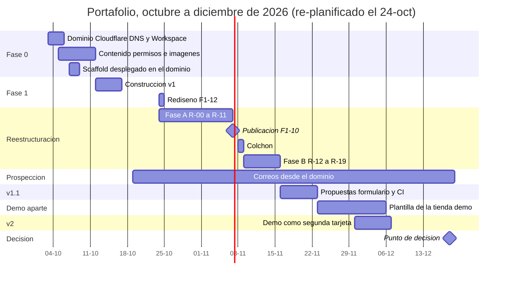
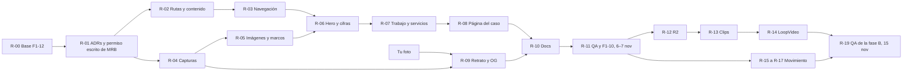
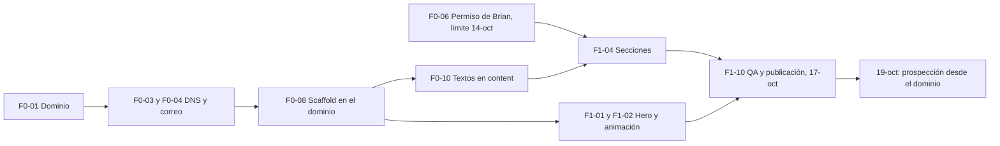

# 13 · Plan de implementación

La v1 se construye en **~7,5 h**, entre el 12 y el 17 de octubre, y se publica el **17**; el 18 queda de colchón. Para lograrlo, la fase 0 adelanta todo lo que no es construir: dominio, DNS, correo, scaffold desplegado, Cal.com y textos. Esto suma unas 3 h a la fase 0, pero deja la semana del festivo libre para el hero y las secciones.

**Re-planificación del 24 de octubre.** La v1 se construyó (F1-01 a F1-09) y se rediseñó (F1-12), pero no se publicó: dijiste que seguía siendo una página plana, sin barra de navegación, imágenes ni video, que no da una buena primera impresión a un cliente. Antes de publicar entra una reestructuración en dos fases ([§5.1](#51-reestructuración-fase-a-24-de-octubre-al-7-de-noviembre) y [§5.2](#52-reestructuración-fase-b-9-al-15-de-noviembre); [ADR-020](./14-decisiones.md#adr-020) a [ADR-023](./14-decisiones.md#adr-023)), y todo lo demás se corre.

Después vienen:

- **Reestructuración, fase A (24 de octubre al 7 de noviembre):** barra fija, página del caso MRB con nombre y capturas reales en marcos de dispositivo. Termina con la publicación (F1-10) el **6–7 de noviembre**.
- **Reestructuración, fase B (9 al 15 de noviembre):** video en Cloudflare R2 y movimiento.
- **v1.1 (16 al 22 de noviembre):** propuestas web, formulario y CI. *(Antes, 19–25 de octubre.)*
- **v2 (30 de noviembre al 6 de diciembre):** la tienda demo, como segunda tarjeta dentro de `#trabajo`. *(Antes, 2–8 de noviembre.)*
- **v3:** opcional, después del 18 de diciembre.

---

## 1. Resumen de fases

| Fase | Fechas | Objetivo | Horas | Entregable |
|---|---|---|---|---|
| 0. Preparación | 3–11 oct | Todo listo para construir sin bloqueos | ~7,5–8,5 (técnicas ~4; contenido ~4–5); ~2 h ideales el 3–4 oct | Dominio con correo autenticado; scaffold en `alejandrodeveloper.com` sobre Cloudflare; Cal.com; textos e imágenes |
| 1. v1 | 12–17 oct (12 festivo); F1-12 el 24-oct | Publicar | ~7,5 | Sitio con hook A, caso, precios, agenda y SEO. **La publicación (F1-10) pasó al cierre de la fase A**, el 6–7 nov |
| R-A. Reestructuración, fase A | 24 oct–7 nov (2 festivo) | Una primera impresión que convenza, y publicar | ~13 | Barra fija con menú, página del caso EN y ES, capturas reales en marcos, franja de cifras y servicios en bento; publicación el 6–7 nov |
| R-B. Reestructuración, fase B | 9–15 nov | Video y movimiento | ~8 | Clips en R2, teaser, revelados al hacer scroll, transiciones de vista y deslizador antes/después |
| 1.1 | 16–22 nov (16 festivo); antes 19–25 oct | Herramientas de cierre y calidad | ~4,25 | Propuestas web, formulario, CI, CSP aplicada |
| 2. v2 | 30 nov–6 dic; antes 2–8 nov | Probar en vivo | ~3 | Tienda demo como segunda tarjeta en `#trabajo` + CTA hacia la demo |
| 3. v3 (opcional) | Después del 18-dic | Prospectos entrantes | 10–15 | Diagnóstico automático ([07 §7](./07-integraciones.md#7-v3-esbozo-del-diagnóstico-automático-hook-c)) |

## 2. Calendario

## 3. Presupuesto semanal de horas

El diagnóstico (§8) supone 8–10 h por semana: unas 4 de "prueba" (sitio y demo), 3 de prospección y 2 de cierre y llamadas.

| Semana | Prueba (sitio y demo) | Prospección | Cierre y llamadas | Total | Nota |
|---|---|---|---|---|---|
| 3–4 oct (fin de semana) | Fase 0: ~2 h (dominio, Cloudflare, DNS, Workspace) | — | — | ~2 h | Adelanta el historial del dominio |
| 5–11 oct | Fase 0: ~6–7 h | 1–2 h (seguimientos desde Gmail a los 15 ya contactados) | 2 h (Real Danesa, Jerrell's) | 9–11 h | Pesada por la fase 0 ampliada y el spike del export (F0-08) |
| 12–18 oct | Fase 1: 7,5 h (festivo el 12) | 1 h | 1–2 h | 9,5–10,5 h | La semana más cargada |
| 19–25 oct | v1.1: 4,25 h | 3 h (15 prospectos nuevos) | 2 h | 9,25 h | **La demo no cabe esta semana** |
| 26 oct–1 nov | Demo: 4 h | 3 h | 2 h | 9 h | La demo arranca aquí |
| 2–8 nov | v2: 3 h + demo: 1–2 h (festivo el 2) | 3 h | 2 h | 9–10 h | Publicación de la v2 el 8 |
| 9 nov–18 dic | Mejoras y demo: 4 h | 3 h | 2 h | 9 h | Thanksgiving el 26-nov reduce el trabajo con EE. UU. |

**Riesgo de capacidad.** El diagnóstico ubicaba la demo entre el 12-oct y el 1-nov; aquí solo tiene unas 5–6 h antes de la v2. Si la demo no está lista el 2-nov:

- Se mueven V11-03 y V11-04 (CI y CSP) a noviembre.
- O se publica la v2 con la versión mínima de la demo (catálogo, carrito y pago de prueba, sin cotización con planos).

**Re-planificación del 24 de octubre.** Desde esa semana rige esta tabla. Las horas de la reestructuración son tuyas, de revisión y coordinación; Claude Code hace la codificación.

| Semana | Prueba (sitio y demo) | Prospección | Cierre y llamadas | Total | Nota |
|---|---|---|---|---|---|
| 24–25 oct (fin de semana) | R-00 y R-01: ~1 h | — | — | ~1 h | Pedir el permiso de MRB por escrito |
| 26 oct–1 nov | Fase A: ~7,75 h (R-02 a R-07) | 3 h | 2 h | ~12,75 h | Por encima de las 8–10 h del diagnóstico |
| 2–8 nov (festivo el 2) | Fase A: ~4,25 h (R-08 a R-11) | 3 h | 2 h | ~9,25 h | **Publicación el 6–7 nov**; colchón el 8 |
| 9–15 nov | Fase B: ~8 h | 3 h | 2 h | ~13 h | La más cargada; si no alcanza, se corta primero la fase B ([§5.2](#52-reestructuración-fase-b-9-al-15-de-noviembre)) |
| 16–22 nov (festivo el 16) | v1.1: 4,25 h | 3 h | 2 h | 9,25 h | **La demo no cabe esta semana** |
| 23–29 nov | Demo: 4 h | 3 h | 2 h | 9 h | Thanksgiving el 26-nov reduce el trabajo con EE. UU. |
| 30 nov–6 dic | v2: 3 h + demo: 1–2 h | 3 h | 2 h | 9–10 h | Publicación de la v2 el 6 |
| 7–18 dic (festivo el 8) | Mejoras y demo: 4 h por semana | 3 h | 2 h | 9 h | Punto de decisión el 18-dic |

La regla de capacidad de arriba sigue igual con las fechas nuevas: si la demo no está lista el 30-nov, se mueven V11-03 y V11-04 o se publica la v2 con la demo mínima.

## 4. Fase 0 (3 al 11 de octubre)

| ID | Tarea | h | Depende de | Listo cuando | Doc |
|---|---|---|---|---|---|
| F0-01 | Cuenta de Cloudflare (plan Free, 2FA) y compra del dominio .com en Cloudflare Registrar, antes del 1-nov (cuando sube el precio), con renovación automática, privacidad WHOIS y bloqueo | 0,25 | — | Dominio activo con DNS en Cloudflare | [10 §2](./10-infraestructura-y-entornos.md#2-dominio) |
| F0-02 | Umami Cloud (Hobby, sitio creado) y repositorio privado en GitHub (raíz = `Code/`) | 0,25 | — | ID de Umami anotado; repositorio creado | [10 §1](./10-infraestructura-y-entornos.md#1-cuentas-y-servicios) |
| F0-03 | Google Workspace: verificación, MX, SPF, DKIM 2048, alias `hola@` y `dmarc@`, 2FA | 0,75 | F0-01 | El correo entra y sale; DKIM autenticando | [10 §4](./10-infraestructura-y-entornos.md#4-google-workspace) |
| F0-04 | DNS restante en Cloudflare: AAAA `www` y Redirect Rule al apex, Resend (`notify.`), Search Console; HSTS y *Always Use HTTPS* | 0,5 | F0-01 | Registros verificados en cada panel | [10 §3](./10-infraestructura-y-entornos.md#3-tabla-dns), [10 §6](./10-infraestructura-y-entornos.md#6-cloudflare) |
| F0-05 | DMARC `p=none` (≥ 48 h después de F0-03) | 0,1 | F0-03 | TXT `_dmarc` publicado | [10 §4](./10-infraestructura-y-entornos.md#4-google-workspace) |
| F0-06 | Pedir a Brian: caso con nombre, cifra de cotizaciones desde el 27-ago, testimonio. **Fecha límite: 14-oct** | 0,25 | — | Correo enviado | [04 §6](./04-i18n-contenido-y-precios.md#6-caso-mrb-con-disclosure) |
| F0-07 | Dirección postal (física, apartado USPS o buzón privado) | variable | — | Dirección definida | [09 §6.3](./09-seguridad-y-privacidad.md#63-estados-unidos-can-spam-y-caloppa) |
| F0-08 | Scaffold desplegado en Cloudflare y spike del export. Detalle debajo de la tabla | 1,25 | F0-02, F0-04 | `https://alejandrodeveloper.com/en` responde con SSL y `noindex`; `/` redirige; el spike pasa | [03](./03-arquitectura.md), [04 §2–3](./04-i18n-contenido-y-precios.md#2-redirección-de-), [10 §6](./10-infraestructura-y-entornos.md#6-cloudflare) |
| F0-09 | Cal.com: cuenta, Calendar y Meet, evento(s) de 15 min, preguntas y consentimiento; confirmar el límite de eventos del plan Free | 0,5 | F0-03 | Reserva de prueba completa | [07 §2.1](./07-integraciones.md#21-configuración-en-calcom-fase-0) |
| F0-10 | Textos EN y ES directamente en `content/{en,es}.ts`: hero, 3 bloques, caso (ambas versiones), proceso, precios, FAQ, sobre mí, cierre, 404 | 2–3 | F0-08 | Compila con todos los textos, sin relleno | [04 §4](./04-i18n-contenido-y-precios.md#4-modelo-de-contenido-tipado), [06 §2](./06-secciones-y-ui.md#2-contenido-por-sección) |
| F0-11 | Imágenes: capturas de MRB (archive.org y sitio nuevo), retrato, OG en EN y ES | 1 | — | Archivos con las medidas de 06 §4 | [06 §4](./06-secciones-y-ui.md#4-imágenes) |
| F0-12 | Producto y marca ficticios verificados | 0,25 | — | Nombre elegido; búsquedas sin coincidencias | [05 §12](./05-hero-animacion.md#12-producto-y-marca-ficticios) |
| F0-13 | WhatsApp Business (perfil, saludo) | 0,25 | — | Perfil listo | [07 §3](./07-integraciones.md#3-whatsapp) |
| F0-14 | Texto de la política de privacidad EN y ES | 0,5 | F0-07 | Texto listo para F1-09 | [09 §6.5](./09-seguridad-y-privacidad.md#65-estructura-de-la-política-de-privacidad) |
| F0-15 | Revisar la cláusula de exclusividad del contrato laboral | — | — | Revisada | [09 §7](./09-seguridad-y-privacidad.md#7-otros-riesgos) |

**F0-08, scaffold desplegado:**

- Next 16.3.8, TypeScript, Tailwind 4, ESLint 9, Prettier.
- Estructura de [03 §4](./03-arquitectura.md#4-estructura-del-repositorio), `[locale]` con `generateStaticParams`, tipos `SiteContent`.
- `next.config.ts` con `output: 'export'`, `images.unoptimized` y `globalNotFound`. Además, `wrangler.jsonc`, `worker/index.ts` (redirecciones de `/`, `/call` y `/llamada`) y `public/_headers` ([03 §6](./03-arquitectura.md#6-rutas-encabezados-y-configuración)).
- `CLAUDE.md`, `.nvmrc` = 24 y `wrangler` ≥ 4.135 como dependencia de desarrollo.
- **`wrangler.jsonc` en `main` antes de conectar Workers Builds.** Si falta, Cloudflare autoconfigura el proyecto con vinext y abre un PR.
- Worker conectado a GitHub con Workers Builds (`PNPM_VERSION`), *Custom Domain* `alejandrodeveloper.com` y una preview de prueba desde una rama ([10 §6](./10-infraestructura-y-entornos.md#6-cloudflare)).
- **Meta `noindex` de prelanzamiento.**
- Desplegado en `alejandrodeveloper.com` con SSL.

**Spike del export (~20 min, primero con `pnpm preview` y luego en producción).** Confirma lo que la documentación no garantiza:

- `out/404.html` es la página bilingüe y una ruta inexistente responde 404. Si no, se aplica el plan B de [ADR-013](./14-decisiones.md#adr-013).
- `/en` responde sin barra final (Cloudflare sirve `en.html`).
- La consola no muestra 404 de archivos `.txt` de RSC: los enlaces internos son `<a>` ([03 §7](./03-arquitectura.md#7-convenciones-de-código)).
- `curl -sI` de `/` con `Accept-Language` en `es` y en `en`, y de `/call`: responden 307 y conservan el query string.
- `curl -sI` de `/en` muestra los encabezados de `_headers`, y la preview de la rama responde con `x-robots-tag: noindex`.

**Prelanzamiento sin indexar.** Desde F0-08, producción es pública en `alejandrodeveloper.com`. Para que Google no indexe un sitio a medio construir, `site.indexable = false` agrega `robots: { index: false }` a todas las páginas. Se pasa a `true` en F1-10.

## 5. Fase 1 (12 al 17 de octubre)

| ID | Tarea | h | Requisitos | Listo cuando | Doc |
|---|---|---|---|---|---|
| F1-01 | Hero estático: H1, subtítulo, CTAs, línea de confianza; escenario en su **estado final** (sin animación) | 0,5 | RF-02 | Se ve bien en 375 px y 1280 px; el elemento LCP es el H1 o, en teléfonos, el subtítulo, ambos estáticos | [05 §2–5](./05-hero-animacion.md#2-composición-y-wireframes) |
| F1-02 | Secuencia de animación. **Corte a 1,5 h** (§11 de 05) | 2 | RF-02 | 4,2 s, una vez; reducir movimiento = estado final; 0 KB de JS | [05](./05-hero-animacion.md) |
| F1-03 | Estructura: tokens AA, fuente, header fijo con CTA, cambio de idioma, enlace para saltar, pie | 0,75 | RF-01, RF-13 | Teclado completo; contraste AA | [06 §3](./06-secciones-y-ui.md#3-sistema-visual) |
| F1-04 | Secciones 2, 3 (`named` y `anonymized`), 5, 7 (`
`), 8 y 9 | 1,25 | RF-04, 05, 07, 09, 10, 11 | Contenido de ambos idiomas; `disclosure` funcionando | [06](./06-secciones-y-ui.md) |
| F1-05 | Precios por país: `Price`, script de mercado, `MarketToggle`, sección 6 | 0,5 | RF-08 | Bogotá → COP; Nueva York → USD; `?mkt=co`; sin CLS | [04 §8](./04-i18n-contenido-y-precios.md#8-precios-por-país-del-visitante) |
| F1-06 | Cal.com: `CalLoader`, enlace de respaldo, `bookingSuccessfulV2`, UTM | 0,5 | RF-15 | Popup sin doble apertura; reserva de prueba con UTM | [07 §2](./07-integraciones.md#2-agenda-con-calcom) |
| F1-07 | Analítica: script de Umami, `track()`, `TrackingListener`, UTM, `landing`, `case_mrb_view` | 0,5 | — | Eventos visibles en Umami tras una navegación de prueba en producción | [12 §4](./12-medicion-y-analitica.md#4-implementación) |
| F1-08 | SEO y headers: metadata, hreflang, OG, JSON-LD, sitemap y robots (`force-static`), `_headers` completo, 404 bilingüe | 0,5 | RF-17, RF-18 | Validadores en verde | [08](./08-seo.md), [09 §2](./09-seguridad-y-privacidad.md#2-encabezados-http) |
| F1-09 | Política de privacidad EN y ES (TSX) | 0,25 | RF-14 | Publicada con versión y fecha | [09 §6.5](./09-seguridad-y-privacidad.md#65-estructura-de-la-política-de-privacidad) |
| F1-10 | QA, `site.indexable = true`, publicación, Search Console y sitemap. **Depende de R-11** (re-planificada el 24-oct: publicación el 6–7 nov, [§5.1](#51-reestructuración-fase-a-24-de-octubre-al-7-de-noviembre)) | 0,75 | — | Checklist de [11 §5](./11-calidad-rendimiento-y-accesibilidad.md#5-checklist-de-lanzamiento) completo | [11](./11-calidad-rendimiento-y-accesibilidad.md) |
| *F1-11 (P1)* | *Formulario de contacto, solo si sobra tiempo* | *1,5* | *RF-12* | *Ver V11-02* | [07 §5](./07-integraciones.md#5-formulario-de-contacto-v11) |
| F1-12 | Rediseño visual con el design system "plano técnico" (detalle debajo de la tabla) | — | RF-01–RF-05, RF-07–RF-11, RF-13, RF-14, RF-18 | **Hecha el 24-oct-2026.**<ul><li>`pnpm lint`, `pnpm typecheck` y `pnpm build` sin errores.</li><li>Coincide con el UI kit a 1280, 1024, 768, 390, 320 y 280 px, sin scroll horizontal.</li><li>Los ids, los `data-track*`, los `data-cal-*`, el cambio de mercado y los `aria-*` siguen iguales.</li></ul> | [06 §3](./06-secciones-y-ui.md#3-sistema-visual), [05](./05-hero-animacion.md), [ADR-019](./14-decisiones.md#adr-019) |

**Total P0: 7,5 h.**

**F1-12, rediseño visual.** Se agregó el 24-oct, a tu pedido y antes de F1-10, así que no está en las 7,5 h. Incluye:

- Tokens en `globals.css`.
- Archivo, recortada y con respaldo ajustado por ancho, e IBM Plex Mono en un solo peso.
- Bandas e índices por sección.
- El H1 con tachado y marcador.
- El escenario restilizado.
- La política de privacidad y el 404.

Quedan dos pendientes, que pasan a la QA de F1-10:

- Revisar el H1 y el sitio en Safari y Firefox. Solo se probó en Chrome.
- Medir PSI con las fuentes nuevas ([11 §1](./11-calidad-rendimiento-y-accesibilidad.md#1-presupuestos-de-rendimiento)).

**Plan por día:**

| Día | Bloque | Tareas |
|---|---|---|
| Lun 12 (festivo) | ~4 h | F1-01 → F1-02 (con corte) → F1-03 |
| Mar 13 | ~1 h | F1-04 |
| Mié 14 | ~1 h | F1-05, F1-06. **Decidir `disclosure` del caso MRB** según la respuesta de Brian |
| Jue 15 | ~1 h | F1-07, F1-08 |
| Vie 16 | ~0,75 h | F1-09 y primera ronda de QA |
| Sáb 17 | ~0,5 h | QA final y **publicación** (F1-10) |
| Dom 18 | Colchón | Correcciones, enlaces con UTM listos para el 19 |

*El plan por día queda como registro: la publicación (F1-10) se movió al cierre de la fase A de la reestructuración, el 6–7 de noviembre (§5.1).*

### 5.1 Reestructuración, fase A (24 de octubre al 7 de noviembre)

Se agregó el 24-oct, a tu pedido y antes de F1-10. Convierte la página única en una home con barra fija y una página por caso, con el trabajo de MRB con nombre y capturas reales ([ADR-020](./14-decisiones.md#adr-020) y [ADR-021](./14-decisiones.md#adr-021)). Las horas son tuyas, de revisión y coordinación; Claude Code hace la codificación. R-04 y R-09 reemplazan a F0-11.

| ID | Tarea | h | Depende de | Fechas | Listo cuando | Doc |
|---|---|---|---|---|---|---|
| R-00 | Commit local de F1-12 como base, sin push | 0,1 | F1-12 | 24 oct | **Hecha el 24-oct-2026** (commit `8ba1036`) | [ADR-019](./14-decisiones.md#adr-019) |
| R-01 | ADR-020 a ADR-023, tareas R-xx en este doc y confirmar por escrito el alcance del permiso de MRB: nombre, logo, capturas, folleto, video y cifras | 0,75 | R-00 | 24–25 oct | ADRs en [14](./14-decisiones.md); correo de MRB guardado con el alcance. **ADRs y tareas escritos el 24-oct; falta el correo de MRB** | [ADR-020](./14-decisiones.md#adr-020) |
| R-02 | Rutas y contenido: `routes.ts`, `cases.ts`, tipos, migración de `caseMrb` a `cases` y de `solves` a `services`, rutas `/en/work/[slug]` y `/es/trabajos/[slug]`, metadata, sitemap y JSON-LD. Corrige el copy del caso: un solo producto con su urgencia, sin carrito de varias piezas ni checkout, e idiomas EN, PT y ES | 1,5 | R-01 | 25–28 oct | <ul><li>Existen `out/en/work/malone-road-belt.html` y `out/es/trabajos/malone-road-belt.html`, y no existen `out/es/work` ni `out/en/trabajos`.</li><li>Con `pnpm preview`, los dos casos dan 200, y `/es/work/…`, `/en/trabajos/…`, `/en/work/x` y `/en/work` dan 404. `/` sigue redirigiendo según el idioma.</li><li>El HTML tiene `hreflang`, canónica, `og:image`, `Article` y `BreadcrumbList`; el sitemap tiene 6 URLs.</li><li>Las cifras sin verificar llevan `// REVIEW(R-08)`.</li></ul>**Hecha el 24-oct**; las comprobaciones con `pnpm preview` se hicieron en R-11 | [04 §1](./04-i18n-contenido-y-precios.md#1-rutas-y-urls), [08](./08-seo.md), [ADR-020](./14-decisiones.md#adr-020) |
| R-03 | Navegación: `PageShell`, `Nav`, menú con Popover, isla `MenuCloser` y navegación en el pie. Barra de 56 px y `scroll-padding-top: 72px` | 1 | R-02 | 27–29 oct | El enlace para saltar funciona. El menú abre, se recorre con Tab y cierra con Esc, al tocar fuera y al tocar un enlace, con el foco de vuelta al botón. El ancla queda visible bajo la barra. "Trabajo" lleva `aria-current` en el caso. **Hecha el 24-oct**, probada en Chrome; faltan Safari y Firefox | [06 §3.5](./06-secciones-y-ui.md#35-movimiento-estados-y-foco), [ADR-020](./14-decisiones.md#adr-020) |
| R-04 | Capturas: sharp como `devDependency`, `scripts/lib/cdp.mjs`, `capture-screens`, `build-images` y el manifest. Tomar las capturas EN (home en pantalla y completa, búsqueda OEM `MB-8830-IC`, producto y cotización con datos ficticios), la home en PT y, en celular, home, producto y cotización | 1,5 | R-01 (permiso) | 25–29 oct | AVIF y WebP en `src/media/mrb/`, dentro de los presupuestos de ADR-021. Ningún dato real de clientes; el cotizador de MRB nunca se envía. No hay capturas de "antes": archive.org no tiene el sitio anterior. **Hecha el 24-oct:** 9 capturas, el logo y el folleto, todas dentro de su presupuesto ([06 §4.2](./06-secciones-y-ui.md#42-inventario-y-presupuestos)) | [06 §4](./06-secciones-y-ui.md#4-imágenes), [ADR-021](./14-decisiones.md#adr-021) |
| R-05 | `ResponsiveImage` (`<picture>` AVIF y WebP con `srcset` y `sizes`) y `DeviceFrame` (navegador y celular dibujados en CSS) | 0,75 | R-04 | 28–30 oct | Sin CLS; los marcos se ven bien de 280 a 1440 px. **Hecha el 24-oct** | [ADR-021](./14-decisiones.md#adr-021) |
| R-06 | Hero: `HeroShowcase` con capturas estáticas y `FiguresStrip`. El escenario pasa al bloque B de Servicios y el H1 se re-temporiza | 1,5 | R-03, R-05 | 29 oct–1 nov | En Lighthouse móvil, el elemento LCP es el H1 o el subtítulo. En celular no se descarga el marco de navegador. En escritorio, la captura lleva `preload` con `media`. Mientras no haya cifra de cotizaciones, su celda se omite sin hueco. **Hecha el 24-oct:** la celda de cotizaciones muestra mientras tanto las marcas OEM; el avatar espera tu foto | [05 §6](./05-hero-animacion.md#6-guardas-de-rendimiento), [ADR-021](./14-decisiones.md#adr-021), [ADR-023](./14-decisiones.md#adr-023) |
| R-07 | Home: `#trabajo` con `CaseCard`, `#servicios` en bento y ajustes de Proceso, Precios y Sobre mí | 1,5 | R-05, R-06 | 30 oct–3 nov | Los `data-track*`, los `data-cal-*` y el cambio de mercado siguen funcionando. `case_open` y `case_mrb_view` en `#trabajo`. Sin scroll horizontal de 280 a 1280 px. **Hecha el 24-oct**; el escenario de Servicios falta en Safari | [06 §1](./06-secciones-y-ui.md#1-mapa-de-secciones), [12 §3](./12-medicion-y-analitica.md#3-taxonomía-de-eventos) |
| R-08 | Página del caso, con el antes/después en paneles de texto: el proceso de antes frente al de después, y capturas en el lado "después". Revisas el copy EN y ES y resuelves los `REVIEW(R-08)` | 1,5 | R-02, R-05, R-07 | 2–4 nov | Copy aprobado en los dos idiomas; ninguna cifra sin verificar en pantalla. **Página construida el 24-oct; falta tu revisión del copy y de los `REVIEW(R-08)`** | [ADR-020](./14-decisiones.md#adr-020) |
| R-09 | Retrato (4:5, 1:1 y avatar) y `build-og` (4 imágenes OG: home y caso, en EN y ES) | 0,75 | R-04; tu foto | 2–4 nov | Imágenes OG de 1200 × 630 y ≤ 300 KB; retrato en los tres cortes. **OG hechas el 24-oct (124–136 KB); falta tu foto para el retrato** | [08 §3](./08-seo.md#3-imágenes-open-graph), [ADR-021](./14-decisiones.md#adr-021) |
| R-10 | Docs de la fase A: 01 a 12, README y `Design system/readme.md` | 0,5 | R-02 a R-09 | 4–5 nov | Los docs describen lo construido. **Hecha el 24-oct** | [README](./README.md) |
| R-20 | ADR-024 y estas tareas: páginas de Servicios y Sobre mí, menús desplegables y demos como casos | 0,25 | R-10 | 25 oct | ADR en [14](./14-decisiones.md#adr-024). **Hecha el 25-oct** | [ADR-024](./14-decisiones.md#adr-024) |
| R-21 | Titular: tachado encima de las letras, la pregunta "¿Sin página web o con una desactualizada?" como línea de público y OG regeneradas | 0,25 | R-20 | 25 oct | H1 en dos líneas en escritorio con la pregunta arriba; OG de 129–136 KB. **Hecha el 25-oct** | [05](./05-hero-animacion.md), [ADR-024](./14-decisiones.md#adr-024) |
| R-22 | Rutas `/en/services`, `/es/servicios`, `/en/about` y `/es/sobre-mi`; barra con 3 menús desplegables, menú de celular por grupos, pie y sitemap de 10 URLs | 0,5 | R-20 | 25 oct | Las combinaciones cruzadas dan 404 (`wrangler dev`); los menús abren y cierran con clic, Esc, al tocar fuera y al tocar un enlace. **Hecha el 25-oct** | [ADR-024](./14-decisiones.md#adr-024) |
| R-23 | Trabajo con varios casos: `kind: 'demo'`, tarjetas que alternan lado, chip de demo sin cifras, texto de introducción de uno o varios casos y "siguiente caso" | 0,25 | R-22 | 25 oct | Probado con un demo temporal en local. **Hecha el 25-oct**; cada demo entra cuando tenga URL y capturas | [ADR-024](./14-decisiones.md#adr-024) |
| R-24 | Página de Servicios: un bloque por servicio, con lo que incluye y los ejemplos de MRB. Revisas el copy y resuelves los `REVIEW(R-24)` | 0,75 | R-22 | 25 oct–4 nov | Copy aprobado en los dos idiomas. **Página construida el 25-oct; falta tu revisión** | [06 §1](./06-secciones-y-ui.md#1-mapa-de-secciones) |
| R-25 | Página Sobre mí (hero, proceso, precios) y su resumen en la home. Revisas el copy de los menús, de Trabajo y de Sobre mí, y resuelves los `REVIEW(R-25)` | 0,5 | R-22 | 25 oct–4 nov | Copy aprobado en los dos idiomas. **Construida el 25-oct; falta tu revisión** | [06 §1](./06-secciones-y-ui.md#1-mapa-de-secciones) |
| R-26 | ADR-025, página de Trabajo (`/en/work`, `/es/trabajos`) con todas las tarjetas, resumen de Trabajo en la home con categorías, industrias y proyectos, y la barra sin el lema. Revisas el copy y resuelves los `REVIEW(R-26)` | 0,75 | R-23 | 25 oct–4 nov | `/es/work` y `/en/trabajos` dan 404; la ruta de navegación de cada caso lleva a la página de Trabajo; el sitemap tiene 12 URLs. **Construida el 25-oct; falta tu revisión** | [ADR-025](./14-decisiones.md#adr-025) |
| R-27 | Servicio de diseño (bento, página de Servicios y menú) y "Que te elijan" sin OEM ni máquina. Revisas el copy y resuelves los `REVIEW(R-27)` | 0,5 | R-24 | 25 oct–4 nov | 7 servicios en el bento, la página y el menú; el ejemplo de diseño muestra el logo y el folleto de MRB. **Construido el 25-oct; falta tu revisión** | [ADR-025](./14-decisiones.md#adr-025) |
| R-28 | Precios ocultos con `site.features.pricing = false` y LinkedIn en su lugar (Sobre mí, su resumen, menú y pie), evento `linkedin_open` y `sameAs`. Revisas el copy y resuelves los `REVIEW(R-28)` | 0,5 | R-25 | 25 oct–4 nov | El HTML publicado no tiene montos tuyos ni enlaces a `#precios`; con `true` todo vuelve. **Construido el 25-oct; falta tu revisión** | [ADR-025](./14-decisiones.md#adr-025) |
| R-11 | QA de la fase A y, al final, F1-10 | 1,5 | R-02 a R-10, R-20 a R-28 | 5–7 nov | <ul><li>`pnpm lint`, `pnpm typecheck` y `pnpm build` sin errores.</li><li>JS de primera carga ≤ 150 KB y CSS ≤ 30 KB, comprimidos.</li><li>Lighthouse móvil: LCP < 2,5 s con el H1 o el subtítulo como elemento LCP, y CLS < 0,1.</li><li>Capturas a 1280, 390, 320 y 280 px sin scroll horizontal; zoom al 200 % y axe.</li><li>`curl -I` de `/_next/static/media/*.avif` muestra `immutable`.</li><li>Después, F1-10: `indexable = true`, push a `main` con tu confirmación, Search Console y PSI en producción (mediana de 3) para `/en`, `/es` y los dos casos.</li></ul>**QA de laboratorio del 24-oct:** lint, typecheck y build sin errores; JS 132,8 KB y CSS 14,7 KB; CLS 0,003; sin scroll horizontal; `immutable` confirmado. **LCP móvil sobre HTTP/2, como Cloudflare: 2,15 s en la home y 2,0 s en los casos**, con el subtítulo y el resumen como elemento LCP. Sobre HTTP/1.1 daba 2,8 s y 2,6 s, pero esa cifra no se compara con producción ([11 §2](./11-calidad-rendimiento-y-accesibilidad.md#2-técnicas-de-rendimiento)). axe sin violaciones (7 páginas, 390 y 1440 px), zoom al 200 % y 400 % y teclado revisados. Faltan PSI en producción, Safari, Firefox y VoiceOver | [11](./11-calidad-rendimiento-y-accesibilidad.md) |

**Total de la fase A: ~17,25 h** (13 h, más las 2,5 h de R-20 a R-25 y las 1,75 h de R-26 a R-28, del 25-oct).

### 5.2 Reestructuración, fase B (9 al 15 de noviembre)

Video y movimiento, después de publicar ([ADR-022](./14-decisiones.md#adr-022) y [ADR-023](./14-decisiones.md#adr-023)). Nada de la fase B bloquea la publicación: la fase A deja una portada estática donde irá cada clip.

| ID | Tarea | h | Depende de | Fechas | Listo cuando | Doc |
|---|---|---|---|---|---|---|
| R-12 | Bucket R2 `web-portfolio-media`, dominio `media.alejandrodeveloper.com`, `r2.dev` apagado, alerta de facturación en US$1 y prueba de `Range` | 0,75 | R-11; R2 activado con tu tarjeta | 9 nov | `curl -sI -H 'Range: bytes=0-1'` devuelve `206` con `Accept-Ranges`, y la segunda petición, `cf-cache-status: HIT` | [10 §6](./10-infraestructura-y-entornos.md#6-cloudflare), [ADR-022](./14-decisiones.md#adr-022) |
| R-13 | Grabas los 3 clips con la grabación de pantalla de macOS, siguiendo el guion: `oem-search` (8 s), `language` (6 s) y `quote-mobile` (10 s). Luego `encode-video` y `upload-media`. El teaser se re-renderiza a 1280 × 720 | 2 | R-12; ffmpeg instalado con Homebrew | 9–11 nov | `ffprobe` confirma los códecs, que no hay audio y que `moov` va al inicio. Pesos dentro de ADR-022. El clip del cotizador se grabó en el entorno local de MRB, con Resend apagado | [ADR-022](./14-decisiones.md#adr-022) |
| R-14 | `LoopVideo`, clips en el hero, en el bento y en el caso, y `media-src` en la CSP | 1 | R-13 | 11–12 nov | Reproduce solo en vista y después de `load`. Pausa visible. Con "reducir movimiento" o Save-Data, solo la portada. La consola no muestra reportes de CSP | [09 §2](./09-seguridad-y-privacidad.md#2-encabezados-http), [ADR-022](./14-decisiones.md#adr-022) |
| R-15 | `CompareSlider` en el antes/después. **Solo si aparece una imagen de "antes"**; si no, se descarta | 0,5 | R-11 | 12–13 nov | Se usa con teclado; sin JS se ven los paneles enfrentados; envía `compare_use` | [ADR-023](./14-decisiones.md#adr-023) |
| R-16 | Revelados al hacer scroll, en CSS | 0,75 | R-11 | 12–13 nov | Con "reducir movimiento" y en Firefox, el contenido se ve completo y sin efectos | [ADR-023](./14-decisiones.md#adr-023) |
| R-17 | Transiciones de vista entre la home y el caso | 0,5 | R-11 | 13 nov | Sin transición con "reducir movimiento" | [ADR-023](./14-decisiones.md#adr-023) |
| R-18 | Teaser con clic para reproducir, portada, "Descripción del video" y `video_play` | 1 | R-12, R-13 | 13–14 nov | Safari en Mac y en iPhone lo reproduce en línea; la descripción se entiende sin ver el video | [12 §3](./12-medicion-y-analitica.md#3-taxonomía-de-eventos), [ADR-022](./14-decisiones.md#adr-022) |
| R-19 | Docs, QA y PSI de la fase B | 1,5 | R-14 a R-18 | 14–15 nov | Safari en Mac y en iPhone, "reducir movimiento", sin JS y Firefox revisados; consola sin reportes de CSP; PSI sin regresiones frente a R-11 | [11](./11-calidad-rendimiento-y-accesibilidad.md) |

**Total de la fase B: ~8 h.** Si la semana no alcanza, se cortan en este orden R-15, R-17 y R-16: ninguna bloquea otra tarea.

### 5.3 Ruta crítica y lo que depende de ti

- **La dependencia más riesgosa** es el alcance del permiso escrito de MRB: condiciona las capturas, el logo y las cifras. Si llega más estrecho, se quitan los campos afectados ([ADR-020](./14-decisiones.md#adr-020)).
- **La tarea técnica más riesgosa** es R-06: el hero con imágenes no puede mover el LCP móvil. Se acota con la regla de [ADR-021](./14-decisiones.md#adr-021): en celular el LCP es texto.
- **Los datos de MRB que faltan no bloquean:** la cifra de cotizaciones, la duración y la fecha de salida son campos opcionales que se omiten sin hueco.
- **Desde la publicación,** los correos de prospección pueden enlazar el caso directamente (`/en/work/malone-road-belt`, `/es/trabajos/malone-road-belt`), con la misma convención de UTM ([12 §5](./12-medicion-y-analitica.md#5-convención-utm)).

**Lo que depende de ti:**

- **Fase A:**
  - El permiso de MRB por escrito (R-01).
  - Para R-08: la cifra de cotizaciones desde el 27-ago y tu OK para publicarla; la duración de la fase 1 de MRB; y la confirmación de las cifras que se verificaron en el sitio el 24-oct: 15 productos (el plan decía 16), 4 líneas (decía 5), 29 marcas OEM (decía 30) y 6 máquinas (decía 7; salen de datos de ejemplo del repositorio de MRB).
  - El portugués ya está publicado: `/pt` responde en portugués (verificado el 24-oct en R-04).
  - Tu foto profesional en alta resolución (R-09).
  - Los pendientes de lanzamiento, para R-11: Cal.com, WhatsApp, dirección postal, HSTS, renovación automática del dominio y DMARC.
- **Fase B:** activar R2 con la tarjeta (R-12), instalar ffmpeg con Homebrew y grabar los 3 clips (R-13).

## 6. v1.1 (16 al 22 de noviembre)

Re-planificada el 24-oct, después de la fase B de la reestructuración (antes, 19–25 de octubre). En orden de prioridad (si falta tiempo, se cortan las últimas):

| ID | Tarea | h | Requisitos | Doc |
|---|---|---|---|---|
| V11-01 | Plantilla de propuestas `/[locale]/p/[slug]` + la primera propuesta real (para el primer prospecto que responda) | 1,5 | RF-16 | [04 §9](./04-i18n-contenido-y-precios.md#9-propuestas-web-v11) |
| V11-02 | Formulario: `ContactForm` + `POST /api/contact` en el Worker + Resend + regla de rate limit + `features.contactForm`. Confirmar si el binding `ratelimits` está disponible en Free y si las previews heredan los secretos | 1,5 | RF-12 | [07 §5](./07-integraciones.md#5-formulario-de-contacto-v11) |
| V11-03 | CI: GitHub Actions con lint, typecheck, build, Playwright, axe y Lighthouse CI | 1 | — | [11 §4.2](./11-calidad-rendimiento-y-accesibilidad.md#42-v11-automatizadas-en-la-ci) |
| V11-04 | Pasar la CSP de Report-Only a aplicada | 0,25 | — | [09 §2](./09-seguridad-y-privacidad.md#2-encabezados-http) |

**Con la reestructuración:**

- **V11-02:** el formulario entra en un panel dentro de `#contacto`.
- **V11-03:** Playwright, axe y Lighthouse CI cubren también las dos páginas del caso.
- **V11-04:** la CSP aplicada incluye el `media-src` de [ADR-022](./14-decisiones.md#adr-022).

## 7. v2 (30 de noviembre al 6 de diciembre)

Re-planificada el 24-oct (antes, 2–8 de noviembre). **La demo entra como segunda tarjeta (`id="demo"`) dentro de `#trabajo`, no como sección aparte, así que los índices 01–07 no se renumeran** ([ADR-020](./14-decisiones.md#adr-020)). Desde la v2, la tarjeta "siguiente caso" de la página del caso lleva a la demo.

| ID | Tarea | h | Requisitos | Doc |
|---|---|---|---|---|
| V2-01 | Cada demo como caso (`kind: 'demo'`, [ADR-024](./14-decisiones.md#adr-024)): entrada en `cases.ts`, capturas, `examples`, copy EN/ES y su página. Antes era una tarjeta `#demo` | 1,5 | RF-06 | [07 §6](./07-integraciones.md#6-tienda-demo-v2-contrato-de-integración) |
| V2-02 | CTA secundario del hero y escenario de la animación apuntan a la demo | 0,25 | RF-02 | [05 §5](./05-hero-animacion.md#5-estructura-del-componente) |
| V2-03 | Verificar el contrato de la demo: `noindex`, banner de prueba, sandbox de Stripe, subidas privadas | 0,5 | — | [07 §6](./07-integraciones.md#6-tienda-demo-v2-contrato-de-integración) |
| V2-04 | QA y PSI (`/en`, `/es` y los dos casos) | 0,75 | — | [11](./11-calidad-rendimiento-y-accesibilidad.md) |

## 8. v3 (opcional, después del 18 de diciembre)

Solo si en el punto de decisión del 18-dic hacen falta prospectos que lleguen solos. Requiere:

- Diseño detallado a partir del esbozo de [07 §7](./07-integraciones.md#7-v3-esbozo-del-diagnóstico-automático-hook-c).
- Una base de datos para leads.
- Actualizar la política de privacidad.

Estimación del roadmap: 10–15 h.

## 9. Definición de terminado (cada tarea)

- [ ] Cumple su criterio de "listo cuando" y los requisitos `RF-xx` asociados.
- [ ] Funciona en `/en` y `/es`. Ningún texto visible quedó en los componentes.
- [ ] `pnpm lint` y `pnpm build` sin errores ni advertencias nuevas.
- [ ] Teclado, foco visible y contraste revisados en lo que tocó la tarea.
- [ ] Sin errores en la consola del navegador.
- [ ] La preview de Cloudflare (enlace en el PR) revisada en móvil.
- [ ] Si cambió una decisión, el ADR de [14](./14-decisiones.md) está actualizado en el mismo PR.

## 10. Ruta crítica

- **La dependencia más riesgosa** es el permiso de Brian. Se neutraliza con la versión anónima construida por defecto.
- **La tarea técnica más riesgosa** es F1-02, la animación. Se acota con el corte a 1,5 h.
- **Los textos (F0-10)** son la ruta crítica menos visible: sin ellos no hay secciones.

Esta es la ruta crítica original de la v1. La de la reestructuración, que termina en la publicación, está en [§5.3](#53-ruta-crítica-y-lo-que-depende-de-ti).

## 11. Riesgos y mitigaciones

| Riesgo | Probabilidad | Impacto | Mitigación | Señal |
|---|---|---|---|---|
| La animación se alarga | Media | Medio | Corte a 1,5 h → versión mínima ([05 §11](./05-hero-animacion.md#11-corte-por-tiempo)) | F1-02 pasa de 1,5 h |
| El permiso de MRB llega tarde o no llega | Media | Bajo | Versión `anonymized` por defecto. *(24-oct: MRB dio permiso; el riesgo pasa a ser su alcance, fila siguiente)* | Sin respuesta al 14-oct |
| El permiso escrito de MRB llega más estrecho (sin cifras, logo o capturas) | Baja | Alto | Campos opcionales y `disclosure` por caso: se quitan los afectados ([ADR-020](./14-decisiones.md#adr-020)) | Respuesta de MRB en R-01 |
| La cifra de cotizaciones de MRB no llega | Media | Bajo | Celda opcional que se omite sin hueco | Sin cifra al empezar R-08 |
| Las imágenes del hero empujan el LCP móvil | Media | Alto | En celular el LCP es texto y las imágenes van después de los CTAs; el marco de navegador no se descarga en celular ([ADR-021](./14-decisiones.md#adr-021)) | Lighthouse móvil en R-06 y R-11 |
| El JS de primera carga pasa de 150 KB | Media | Medio | Las islas nuevas suman ≤ ~3 KB; se mide en cada fase ([ADR-020](./14-decisiones.md#adr-020)) | Reporte del build en R-11 y R-19 |
| La fase B no cabe en su semana | Alta | Bajo | Se cortan R-15, R-17 y R-16, en ese orden; no bloquean nada ([§5.2](#52-reestructuración-fase-b-9-al-15-de-noviembre)) | R-19 sin terminar el 15-nov |
| Safari no reproduce los clips | Baja | Medio | R2 con respuestas `206`, MP4 H.264 con `+faststart` como respaldo y portada siempre visible ([ADR-022](./14-decisiones.md#adr-022)) | Prueba de `Range` en R-12; Safari en R-19 |
| Aparecen datos reales de clientes en capturas o clips, o un correo real llega a MRB | Baja | Alto | Datos ficticios; el cotizador de producción nunca se envía; el clip del cotizador se graba en local con Resend apagado | Revisión de cada captura en R-04 y de cada clip en R-13 |
| R2 cobra un excedente | Muy baja | Bajo | Unos 15 MB de video frente a 10 GB gratis; alerta de facturación en US$1 | Correo de la alerta |
| Los textos no están listos el 11-oct | Media | Alto | Escribirlos directo en `content/*.ts` en la fase 0; FAQ con 5 preguntas si falta tiempo | F0-10 incompleta el 11 |
| Problemas de DNS o SSL | Baja | Alto | Se hace en la fase 0, con días de margen | El dominio no resuelve el 8-oct |
| Baja entregabilidad del dominio nuevo | Media | Alto | Calentamiento, volumen bajo, 1 a 1, SPF, DKIM y DMARC ([10 §5](./10-infraestructura-y-entornos.md#5-entregabilidad-del-dominio-nuevo)) | Rebotes, correos en spam |
| El plan Free de Cal.com limita los eventos | Media | Bajo | Un solo evento con etiquetas bilingües ([07 §2.1](./07-integraciones.md#21-configuración-en-calcom-fase-0)) | F0-09 |
| PSI por debajo de 90 | Baja | Medio | Presupuestos de [11 §1](./11-calidad-rendimiento-y-accesibilidad.md#1-presupuestos-de-rendimiento); revisar el elemento LCP, los terceros y el JS | PSI en la QA |
| La demo compite por las mismas horas | Alta | Medio | Prioridades de la v1.1; v2 con la demo mínima (§3) | La demo sin catálogo el 1-nov |
| Parche de seguridad de Next.js durante el trabajo | Media | Bajo | Actualizar en menos de 48 h ([02 §4](./02-stack-tecnologico.md#4-política-de-versiones)) | Aviso de seguridad |
| ESLint 10 se instala por error | Media | Bajo | Fijar ESLint 9.39.x | El lint falla al instalar |
| Node local (26) distinto del build de Cloudflare (24) | Alta | Bajo | `nvm use 24` y `.nvmrc` | Diferencias entre local y preview |
| `global-not-found` (experimental) falla o no genera `out/404.html` | Baja | Bajo | Usar el 404 por defecto de Next | El spike de F0-08 o el build fallan |
| El export de Next 16 trae sorpresas: 404 en el prefetch de RSC, o OG y 404 que no se generan | Media | Medio | Spike en F0-08; enlaces internos con `<a>`; `force-static` en sitemap, robots y OG ([ADR-017](./14-decisiones.md#adr-017)) | El spike de F0-08 falla |
| El Worker pasa de 100.000 invocaciones en un día | Muy baja | Bajo | Solo `/`, `/call` y `/llamada` pasan por él; los correos enlazan a `/en` y `/es`, que no dependen del Worker. Si se repite, Workers Paid (US$5) | 429 en `/`; alerta del monitoreo |
| Workers Builds autoconfigura el proyecto con vinext | Media | Bajo | Commitear `wrangler.jsonc` antes de conectar el repositorio | Aparece un PR automático de Cloudflare |
| Google indexa el sitio antes del lanzamiento | Media | Bajo | `site.indexable = false` hasta F1-10 | — |
| Perfeccionismo (roadmap §10) | Alta | Alto | Definición de terminado, P0/P1 y cortes por tiempo | La fase 1 pasa de 8 h |

## 12. Cómo pedir cada tarea a Claude Code

Una tarea por sesión o PR, citando su ID y sus docs:

> *Implementa F1-05 de docs/13-plan-de-implementacion.md siguiendo docs/04-i18n-contenido-y-precios.md §8. No cambies decisiones de docs/14-decisiones.md. Al terminar, verifica el criterio "listo cuando" y la definición de terminado (§9), y dime qué quedó pendiente.*

Para revisar el avance:

> *Lee docs/13 y dime qué tareas P0 de la fase 1 faltan, en qué orden harías las que quedan y qué riesgo ves.*
